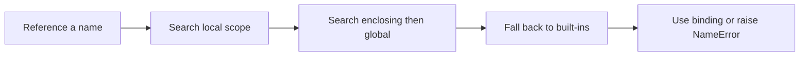

> **Level 1: Beginner** · Topic 24 of 35

[← Return Statements](./23-return-statements.md) · [↑ Level index](../README.md) · [Lambda Functions →](./25-lambda-functions.md)

# Scope

## Overview
- **What is it?** Scope determines where a name can be accessed; Python resolves names through local, enclosing, global, then built-in scopes.
- **Why is it important?** Clear scope limits unintended coupling and prevents one function from silently changing unrelated state.
- **Where is it used?** Every function, nested function, module, and comprehension creates or interacts with name-resolution boundaries.

## Learning Objectives
- Identify local, enclosing, global, and built-in names.
- Explain shadowing and the lifetime of local names.
- Use return values instead of `global`, and understand when `nonlocal` is appropriate.

## Real World Applications
- Keep temporary calculations private to a function.
- Create a closure that remembers configuration.
- Share module constants without hiding mutable state changes.

## Core Concepts

### Local and global names
- **Definition:** Assignment inside a function creates a local name unless declared otherwise; module-level names are global to that module.
- **Visual explanation:** `module global -> function call -> local namespace`
- **Practical example:**

```python
course = "Python"

def show_course():
    message = course
    print(message)

show_course()
```

### LEGB lookup
- **Definition:** A name reference searches Local, Enclosing, Global, and Built-in namespaces in that order.
- **Visual explanation:** `L -> E -> G -> B -> NameError`
- **Practical example:**

```python
label = "global"

def outer():
    label = "enclosing"
    def inner():
        print(label)
    inner()

outer()
```

### Controlled state changes
- **Definition:** `nonlocal` rebinds a name in an enclosing function; returning new state is often clearer than mutating globals.
- **Visual explanation:** `inner assignment -> declared enclosing binding`
- **Practical example:**

```python
def make_counter():
    count = 0
    def increment():
        nonlocal count
        count += 1
        return count
    return increment

counter = make_counter()
print(counter(), counter())
```

## Infographic Summary

| Infographic Block | Topic-Specific Takeaway |
| --- | --- |
| 📌 Concept | Scope determines where a name can be accessed; Python resolves names through local, enclosing, global, then built-in scopes. |
| ⚡ Purpose | Control where names are visible and how Python resolves each reference. |
| 🔥 Benefits | Clear scope limits unintended coupling and prevents one function from silently changing unrelated state. |
| 🎯 Use Cases | Every function, nested function, module, and comprehension creates or interacts with name-resolution boundaries. |
| 🚀 Best Practices | Pass dependencies as arguments and return results; reserve module globals for constants and `nonlocal` for deliberate closures. |
| ❌ Common Mistakes | Assigning inside a function while expecting Python to update a same-named global automatically. |

## Syntax Guide

### Basic Syntax

```python
topic = "scope"

def display():
    local_message = topic.upper()
    print(local_message)

display()
```

### Standard Structure

```python
tax_rate = 0.08

def total_with_tax(subtotal):
    tax = subtotal * tax_rate
    return subtotal + tax

print(total_with_tax(50))
```

### Code Pattern

```python
def make_multiplier(factor):
    def multiply(value):
        return value * factor
    return multiply

double = make_multiplier(2)
triple = make_multiplier(3)
print(double(5), triple(5))
```

## Examples

### Beginner Example

```python
name = "global"

def show():
    name = "local"
    print(name)

show()
print(name)
```

### Intermediate Example

```python
currency = "USD"
def format_price(amount):
    symbol = "$"
    return f"{symbol}{amount:.2f} {currency}"
print(format_price(9.5))
```

### Advanced Example

```python
def make_scoreboard():
    scores = []
    def add(score):
        scores.append(score)
        return sum(scores) / len(scores)
    return add
record = make_scoreboard()
print(record(80))
print(record(90))
```

## Workflow Diagram



---

[← Return Statements](./23-return-statements.md) · [↑ Level index](../README.md) · [Lambda Functions →](./25-lambda-functions.md)
