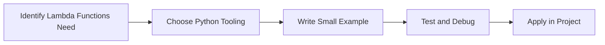

> **Level 1: Beginner** · Topic 25 of 35

[← Scope](./24-scope.md) · [↑ Level index](../README.md) · [Modules →](./26-modules.md)

# Lambda Functions

## Overview
- **What is it?** Lambda functions are small anonymous functions written as expressions.
- **Why is it important?** Pass simple behavior into higher-order functions.
- **Where is it used?** Software teams, education, automation, analytics, and backend development.

## Learning Objectives
- Gain the practical skill to explain, write, debug, and review lambda functions code.
- Cover the vocabulary, syntax, workflow, edge cases, and professional habits behind lambda functions.
- Expected outcome: you can use lambda functions in a small project and recognize when it belongs in production code.

## Real World Applications
- **Industry use cases:** Software teams, education, automation, analytics, and backend development.
- **Business applications:** Reduce manual work, improve reliability, support reporting, automate decisions, and ship maintainable features.
- **Career relevance:** Supports Python developer, backend engineer, data engineer, AI engineer, DevOps engineer, QA automation, and cybersecurity automation roles.

## Core Concepts

### Mental Model
- **Definition:** The main idea that gives lambda functions its structure and purpose inside a Python program.
- **Visual explanation:** `problem -> Lambda Functions model -> clear code`
- **Practical example:**

```python
apply_lambda_functions_label = "Lambda Functions"
print(apply_lambda_functions_label)
```

### Execution Flow
- **Definition:** The ordered steps Python follows when lambda functions code is created, executed, or integrated.
- **Visual explanation:** `input -> Python operation -> result -> feedback`
- **Practical example:**

```python
square = lambda number: number * number
print(square(5))
```

### Quality Rule
- **Definition:** The reliability habit that keeps lambda functions understandable, testable, secure, and maintainable.
- **Visual explanation:** `working code -> validation -> production confidence`
- **Practical example:**

```python
users = [{"name": "Ada", "score": 90}, {"name": "Lin", "score": 95}]
print(sorted(users, key=lambda user: user["score"]))
```

## Infographic Summary

| Infographic Block | Key Message |
| --- | --- |
| 📌 Concept | Lambda Functions belongs to the core programming foundation part of Python mastery. |
| ⚡ Purpose | Pass simple behavior into higher-order functions. |
| 🔥 Benefits | Sorting keys, quick transformations, callbacks, and filters. |
| 🎯 Use Cases | Software teams, education, automation, analytics, and backend development. |
| 🚀 Best Practices | Prefer readable names, small examples, explicit errors, tests, documentation, and version-aware choices. |
| ❌ Common Mistakes | Copying code without understanding it, ignoring edge cases, skipping validation, and mixing unrelated responsibilities. |

## Syntax Guide

### Basic Syntax

```python
double = lambda value: value * 2
print(double(4))
```

### Standard Structure

```python
def apply_lambda_functions(value):
    """Apply the Lambda Functions concept to one value."""
    return value

result = apply_lambda_functions("practice")
print(result)
```

### Code Pattern

```python
# 1. Identify the Lambda Functions problem
# 2. Apply the correct Python structure
# 3. Validate the result with tests or output
```

## Examples

### Beginner Example

```python
square = lambda number: number * number
print(square(5))
```

### Intermediate Example

```python
users = [{"name": "Ada", "score": 90}, {"name": "Lin", "score": 95}]
print(sorted(users, key=lambda user: user["score"]))
```

### Advanced Example

```python
from functools import reduce

product = reduce(lambda left, right: left * right, [2, 3, 4])
print(product)
```

## Workflow Diagram




---

---

[← Scope](./24-scope.md) · [↑ Level index](../README.md) · [Modules →](./26-modules.md)
