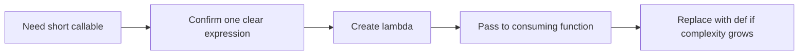

> **Level 1: Beginner** · Topic 25 of 35

[← Scope](./24-scope.md) · [↑ Level index](../README.md) · [Modules →](./26-modules.md)

# Lambda Functions

## Overview
- **What is it?** A lambda expression creates a small anonymous function containing one expression.
- **Why is it important?** Lambdas are useful when an operation is short, local, and passed directly to another function.
- **Where is it used?** Sorting keys, simple transformations, and callback-style APIs frequently accept lambdas.

## Learning Objectives
- Write and call a lambda expression.
- Pass lambdas as `key` functions.
- Choose a named `def` when logic, reuse, typing, or documentation grows.

## Real World Applications
- Sort records by a selected field.
- Transform items with `map` in APIs that require a callable.
- Configure a one-line calculation at the call site.

## Core Concepts

### Expression function
- **Definition:** The form `lambda parameters: expression` evaluates that one expression and returns its value.
- **Visual explanation:** `arguments -> one expression -> result`
- **Practical example:**

```python
double = lambda number: number * 2
print(double(5))
```

### Callable as data
- **Definition:** A lambda is a function object that can be stored or passed where another function expects behavior.
- **Visual explanation:** `lambda -> callable argument -> host operation`
- **Practical example:**

```python
words = ["pear", "fig", "banana"]
print(sorted(words, key=lambda word: len(word)))
```

### Readability boundary
- **Definition:** A lambda cannot contain statements and becomes hard to read when it embeds multiple conditions or repeated logic.
- **Visual explanation:** `simple local expression -> lambda; richer behavior -> def`
- **Practical example:**

```python
records = [{"name": "Bo", "score": 81}, {"name": "Ana", "score": 92}]
ranked = sorted(records, key=lambda record: record["score"], reverse=True)
print(ranked)
```

## Infographic Summary

| Infographic Block | Topic-Specific Takeaway |
| --- | --- |
| 📌 Concept | A lambda expression creates a small anonymous function containing one expression. |
| ⚡ Purpose | Provide a short one-expression callable where behavior is passed as data. |
| 🔥 Benefits | Lambdas are useful when an operation is short, local, and passed directly to another function. |
| 🎯 Use Cases | Sorting keys, simple transformations, and callback-style APIs frequently accept lambdas. |
| 🚀 Best Practices | Use lambdas for obvious one-expression behavior, especially a `key`; give nontrivial logic a descriptive function name. |
| ❌ Common Mistakes | Packing complex branching into a lambda merely to avoid writing `def`. |

## Syntax Guide

### Basic Syntax

```python
square = lambda value: value ** 2
print(square(6))
```

### Standard Structure

```python
names = ["Zara", "amy", "MILO"]
print(sorted(names, key=lambda name: name.lower()))
```

### Code Pattern

```python
products = [
    {"name": "Pen", "price": 3.0},
    {"name": "Book", "price": 8.0},
]
priced = sorted(products, key=lambda product: (product["price"], product["name"]))
print(priced)
```

## Examples

### Beginner Example

```python
add_tax = lambda price: price * 1.08
print(add_tax(20))
```

### Intermediate Example

```python
points = [(2, 5), (1, 9), (4, 3)]
by_y = sorted(points, key=lambda point: point[1])
print(by_y)
```

### Advanced Example

```python
students = [
    {"name": "Mia", "score": 88},
    {"name": "Ali", "score": 88},
    {"name": "Zoe", "score": 95},
]
ranked = sorted(students, key=lambda student: (-student["score"], student["name"]))
print(ranked)
```

## Workflow Diagram



---

[← Scope](./24-scope.md) · [↑ Level index](../README.md) · [Modules →](./26-modules.md)
