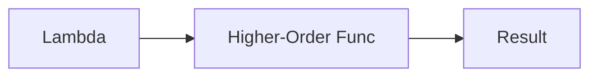

# Lambda Functions

## Overview

- **What is it?** Lambda functions are anonymous one-expression functions.
- **Why is it important?** They shine as short callbacks for sort keys and functional helpers.
- **Where is it used?** sorted/key=, map/filter, pandas apply, event handlers.

## Learning Objectives

- **Skills gained:** Practical command of Lambda Functions.
- **Concepts covered:**

- Write simple lambda expressions.
- Use with sorted, map, filter.
- Know when def is clearer.

- **Expected outcome:** You apply lambdas appropriately without harming readability.

## Real World Applications

- Data wrangling
- UI tooling
- Competitive programming
- Config DSLs

- **Business applications:** Automate workflows, reduce manual errors, accelerate delivery.
- **Career relevance:** Required knowledge for Python roles from junior developer to senior engineer.

## Core Concepts

### Syntax

- **Definition:** lambda params: expression.
- **Visual explanation:** `Syntax` → process → result
- **Practical example:**

```python
double = lambda x: x * 2
print(double(3))
```

### sorted key

- **Definition:** Customize ordering.
- **Visual explanation:** `sorted key` → process → result
- **Practical example:**

```python
pairs = [(1, 'b'), (2, 'a')]
print(sorted(pairs, key=lambda p: p[1]))
```

### map/filter

- **Definition:** Functional transforms.
- **Visual explanation:** `map/filter` → process → result
- **Practical example:**

```python
print(list(map(lambda x: x * 2, [1, 2, 3])))
```

## Infographic Summary

| Block | Summary |
| --- | --- |
| 📌 Concept | Lambdas are expressions that create function objects. |
| ⚡ Purpose | Inline tiny functions at point of use. |
| 🔥 Benefits | Concise sort keys, quick transforms. |
| 🎯 Use Cases | Sorting records, simple predicates, callback slots. |
| 🚀 Best Practices | Use def for multi-line or complex logic; add types at boundaries. |
| ❌ Common Mistakes | Over nesting lambdas, side effects inside, unreadable one-liners. |

## Syntax Guide

### Basic Syntax

```python
square = lambda n: n * n
print(square(5))
```

### Standard Structure

```python
lambda params: expr -> pass to higher-order func
```

### Code Pattern

```python
sorted(items, key=lambda x: x['score'], reverse=True)
```

## Examples

### Beginner Example

```python
nums = [1, 2, 3]
print(list(map(lambda x: x ** 2, nums)))
```

### Intermediate Example

```python
employees = [{'name': 'Ada', 'age': 36}, {'name': 'Lin', 'age': 30}]
print(sorted(employees, key=lambda e: e['age']))
```

### Advanced Example

```python
from functools import reduce

print(reduce(lambda acc, x: acc + x, [1, 2, 3, 4], 0))
```

## Workflow Diagram



---
