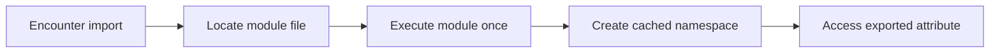

> **Level 1: Beginner** · Topic 26 of 35

[← Lambda Functions](./25-lambda-functions.md) · [↑ Level index](../README.md) · [Packages →](./27-packages.md)

# Modules

## Overview
- **What is it?** A module is one Python file loaded as a namespace, allowing its functions, classes, and constants to be imported elsewhere.
- **Why is it important?** Modules separate responsibilities and make definitions reusable without copying code.
- **Where is it used?** Applications divide calculations, configuration, I/O, and tests across modules.

## Learning Objectives
- Import a module or selected names.
- Explain module namespaces, caching in `sys.modules`, and `__name__`.
- Design a module that can be imported without unintended work.

## Real World Applications
- Reuse standard-library functionality.
- Split a script into focused Python files.
- Expose a stable helper API to tests and other modules.

## Core Concepts

### Module namespace
- **Definition:** Importing a module creates or reuses a module object whose attributes are accessed with dot notation.
- **Visual explanation:** `module.py -> import -> module namespace`
- **Practical example:**

```python
import math
print(math.pi, math.sqrt(16))
```

### Import forms
- **Definition:** `import name` preserves the namespace; `from name import item` binds selected attributes directly.
- **Visual explanation:** `module namespace -> chosen import binding`
- **Practical example:**

```python
from pathlib import Path
current = Path(".")
print(current.resolve().name)
```

### Import-safe execution
- **Definition:** A `__name__ == '__main__'` guard runs command-line behavior only when the file is executed directly.
- **Visual explanation:** `import -> definitions only; direct run -> main function`
- **Practical example:**

```python
def main():
    print("Run as a script")

if __name__ == "__main__":
    main()
```

## Infographic Summary

| Infographic Block | Topic-Specific Takeaway |
| --- | --- |
| 📌 Concept | A module is one Python file loaded as a namespace, allowing its functions, classes, and constants to be imported elsewhere. |
| ⚡ Purpose | Organize reusable definitions in a Python file with its own importable namespace. |
| 🔥 Benefits | Modules separate responsibilities and make definitions reusable without copying code. |
| 🎯 Use Cases | Applications divide calculations, configuration, I/O, and tests across modules. |
| 🚀 Best Practices | Keep top-level module work lightweight, import namespaces clearly, and put script behavior behind a main guard. |
| ❌ Common Mistakes | Naming a file after a standard-library module such as `random.py`, causing the local file to shadow the intended import. |

## Syntax Guide

### Basic Syntax

```python
import statistics
print(statistics.mean([4, 6, 8]))
```

### Standard Structure

```python
from math import ceil, pi
radius = 2
print(ceil(pi * radius ** 2))
```

### Code Pattern

```python
import json

def encode_record(record):
    return json.dumps(record, sort_keys=True)

if __name__ == "__main__":
    print(encode_record({"name": "Ada", "level": 1}))
```

## Examples

### Beginner Example

```python
import math
print(math.factorial(5))
```

### Intermediate Example

```python
import collections
counts = collections.Counter("banana")
print(counts.most_common(2))
```

### Advanced Example

```python
from pathlib import Path
import json

def configuration_text(settings):
    return json.dumps(settings, indent=2)

def main():
    output_name = Path("settings.json").name
    print(output_name)
    print(configuration_text({"theme": "dark"}))

if __name__ == "__main__":
    main()
```

## Workflow Diagram



---

[← Lambda Functions](./25-lambda-functions.md) · [↑ Level index](../README.md) · [Packages →](./27-packages.md)
