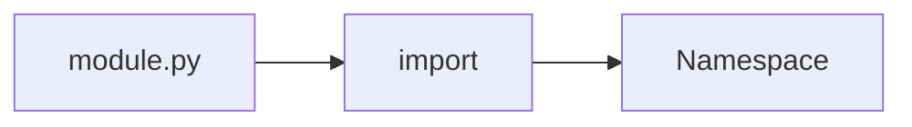

# Modules

## Overview

- **What is it?** Modules are Python files that group related code and expose a namespace.
- **Why is it important?** Modules organize code, enable reuse, and control what is public.
- **Where is it used?** Standard library, internal packages, shared utilities.

## Learning Objectives

- **Skills gained:** Practical command of Modules.
- **Concepts covered:**

- Import modules and names correctly.
- Understand __name__ and __main__.
- Structure module-level code.

- **Expected outcome:** You split programs into importable modules cleanly.

## Real World Applications

- Monoliths
- Shared libs
- Notebooks
- Microservices

- **Business applications:** Automate workflows, reduce manual errors, accelerate delivery.
- **Career relevance:** Required knowledge for Python roles from junior developer to senior engineer.

## Core Concepts

### import

- **Definition:** Load module namespace.
- **Visual explanation:** `import` → process → result
- **Practical example:**

```python
import math
print(math.sqrt(9))
```

### from import

- **Definition:** Bind specific names.
- **Visual explanation:** `from import` → process → result
- **Practical example:**

```python
from math import pi
print(round(pi, 2))
```

### __name__

- **Definition:** Tells if module is run or imported.
- **Visual explanation:** `__name__` → process → result
- **Practical example:**

```python
print(__name__)
```

## Infographic Summary

| Block | Summary |
| --- | --- |
| 📌 Concept | Modules are the unit of reuse in Python. |
| ⚡ Purpose | Encapsulate related functions, classes, constants. |
| 🔥 Benefits | Namespace control, testability, lazy loading. |
| 🎯 Use Cases | Utils, models, clients, constants. |
| 🚀 Best Practices | Explicit __all__; guard main with if __name__. |
| ❌ Common Mistakes | Circular imports, star imports, heavy work at import time. |

## Syntax Guide

### Basic Syntax

```python
import json
print(json.dumps({'a': 1}))
```

### Standard Structure

```python
imports -> constants -> defs -> main guard
```

### Code Pattern

```python
if __name__ == '__main__':
    main()
```

## Examples

### Beginner Example

```python
import datetime
print(datetime.date.today())
```

### Intermediate Example

```python
import importlib.util
spec = importlib.util.find_spec('pathlib')
print(spec is not None)
```

### Advanced Example

```python
import importlib
math = importlib.import_module('math')
print(math.hypot(3, 4))
```

## Workflow Diagram



---
