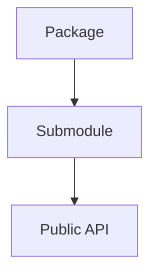

# Packages

## Overview

- **What is it?** Packages are directories of modules with an __init__.py (or namespace package).
- **Why is it important?** Packages scale codebases beyond single files and define public APIs.
- **Where is it used?** Libraries, services, frameworks, internal platforms.

## Learning Objectives

- **Skills gained:** Practical command of Packages.
- **Concepts covered:**

- Create package layout with submodules.
- Import from packages correctly.
- Expose stable __all__ or submodules.

- **Expected outcome:** You organize multi-module projects into installable packages.

## Real World Applications

- PyPI libraries
- Enterprise apps
- ML repos
- Platform SDKs

- **Business applications:** Automate workflows, reduce manual errors, accelerate delivery.
- **Career relevance:** Required knowledge for Python roles from junior developer to senior engineer.

## Core Concepts

### Package dir

- **Definition:** Folder with __init__.py.
- **Visual explanation:** `Package dir` → process → result
- **Practical example:**

```python
from pathlib import Path
print(Path('snippet_parts/_helpers.py').exists())
```

### Relative import

- **Definition:** Import within package.
- **Visual explanation:** `Relative import` → process → result
- **Practical example:**

```python
from snippet_parts._helpers import S
print(callable(S))
```

### __init__

- **Definition:** Runs when package imported.
- **Visual explanation:** `__init__` → process → result
- **Practical example:**

```python
import snippet_parts
print(snippet_parts.__file__)
```

## Infographic Summary

| Block | Summary |
| --- | --- |
| 📌 Concept | Packages group modules under a shared name. |
| ⚡ Purpose | Scale structure and distribution. |
| 🔥 Benefits | Clear boundaries, versioning, reuse. |
| 🎯 Use Cases | Web apps, SDKs, data platforms. |
| 🚀 Best Practices | Flat is better than nested; document public API. |
| ❌ Common Mistakes | Deep circular imports, bloated __init__, missing pyproject. |

## Syntax Guide

### Basic Syntax

```python
from snippet_parts._helpers import S
```

### Standard Structure

```python
package/ -> submodules -> __init__ exports
```

### Code Pattern

```python
from mypkg.services import billing
```

## Examples

### Beginner Example

```python
import snippet_parts
print(snippet_parts.__name__)
```

### Intermediate Example

```python
import pkgutil
print(any(m.name == '_helpers' for m in pkgutil.iter_modules(['snippet_parts'])))
```

### Advanced Example

```python
import importlib.metadata as md
print(md.version('pip'))
```

## Workflow Diagram



---
