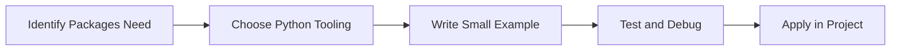

> **Level 1: Beginner** · Topic 27 of 35

[← Modules](./26-modules.md) · [↑ Level index](../README.md) · [Date and Time →](./28-date-and-time.md)

# Packages

## Overview
- **What is it?** Packages are directories of modules organized with package metadata.
- **Why is it important?** Group related code into distributable namespaces.
- **Where is it used?** Software teams, education, automation, analytics, and backend development.

## Learning Objectives
- Gain the practical skill to explain, write, debug, and review packages code.
- Cover the vocabulary, syntax, workflow, edge cases, and professional habits behind packages.
- Expected outcome: you can use packages in a small project and recognize when it belongs in production code.

## Real World Applications
- **Industry use cases:** Software teams, education, automation, analytics, and backend development.
- **Business applications:** Reduce manual work, improve reliability, support reporting, automate decisions, and ship maintainable features.
- **Career relevance:** Supports Python developer, backend engineer, data engineer, AI engineer, DevOps engineer, QA automation, and cybersecurity automation roles.

## Core Concepts

### Mental Model
- **Definition:** The main idea that gives packages its structure and purpose inside a Python program.
- **Visual explanation:** `problem -> Packages model -> clear code`
- **Practical example:**

```python
apply_packages_label = "Packages"
print(apply_packages_label)
```

### Execution Flow
- **Definition:** The ordered steps Python follows when packages code is created, executed, or integrated.
- **Visual explanation:** `input -> Python operation -> result -> feedback`
- **Practical example:**

```python
import platform
print(platform.python_version())
```

### Quality Rule
- **Definition:** The reliability habit that keeps packages understandable, testable, secure, and maintainable.
- **Visual explanation:** `working code -> validation -> production confidence`
- **Practical example:**

```python
import sys

if sys.version_info < (3, 12):
    raise RuntimeError("Python 3.12 or newer is recommended")
print("Python version is ready")
```

## Infographic Summary

| Infographic Block | Key Message |
| --- | --- |
| 📌 Concept | Packages belongs to the core programming foundation part of Python mastery. |
| ⚡ Purpose | Group related code into distributable namespaces. |
| 🔥 Benefits | SDKs, applications, plugins, and shared internal libraries. |
| 🎯 Use Cases | Software teams, education, automation, analytics, and backend development. |
| 🚀 Best Practices | Prefer readable names, small examples, explicit errors, tests, documentation, and version-aware choices. |
| ❌ Common Mistakes | Copying code without understanding it, ignoring edge cases, skipping validation, and mixing unrelated responsibilities. |

## Syntax Guide

### Basic Syntax

```python
import sys
print(sys.version)
print(sys.executable)
```

### Standard Structure

```python
def apply_packages(value):
    """Apply the Packages concept to one value."""
    return value

result = apply_packages("practice")
print(result)
```

### Code Pattern

```python
# 1. Identify the Packages problem
# 2. Apply the correct Python structure
# 3. Validate the result with tests or output
```

## Examples

### Beginner Example

```python
import platform
print(platform.python_version())
```

### Intermediate Example

```python
import sys

if sys.version_info < (3, 12):
    raise RuntimeError("Python 3.12 or newer is recommended")
print("Python version is ready")
```

### Advanced Example

```python
from pathlib import Path
import sys

project = Path.cwd()
print({"python": sys.version.split()[0], "project": project.name})
```

## Workflow Diagram




---

---

[← Modules](./26-modules.md) · [↑ Level index](../README.md) · [Date and Time →](./28-date-and-time.md)
