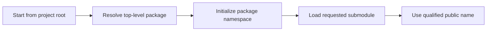

> **Level 1: Beginner** · Topic 27 of 35

[← Modules](./26-modules.md) · [↑ Level index](../README.md) · [Date and Time →](./28-date-and-time.md)

# Packages

## Overview
- **What is it?** A package is an importable directory that groups related modules under a shared namespace.
- **Why is it important?** Packages scale organization beyond one file and support explicit public interfaces and distribution.
- **Where is it used?** Libraries and applications group models, services, utilities, and subfeatures into packages.

## Learning Objectives
- Distinguish a module file from a package directory.
- Use absolute and relative imports within a package.
- Understand the role of `__init__.py` and running package code with `-m`.

## Real World Applications
- Organize a multi-feature application.
- Publish a reusable library namespace.
- Avoid collisions between similarly named modules.

## Core Concepts

### Package layout
- **Definition:** A regular package is a directory containing `__init__.py` plus modules or subpackages.
- **Visual explanation:** `shop package -> __init__.py + pricing.py + reports.py`
- **Practical example:**

```python
from pathlib import PurePath
package_file = PurePath("shop") / "__init__.py"
print(package_file)
```

### Qualified imports
- **Definition:** Absolute imports start from the top-level package; relative imports use dots from the current package.
- **Visual explanation:** `shop.reports -> import shop.pricing`
- **Practical example:**

```python
import importlib
json_package = importlib.import_module("json")
print(json_package.__package__)
```

### Package execution
- **Definition:** `python -m package.module` resolves imports using the package context, unlike executing an internal file path directly.
- **Visual explanation:** `project root -> -m package.module -> package-aware execution`
- **Practical example:**

```python
import runpy
module_data = runpy.run_module("json.tool", run_name="lesson_probe")
print("__name__" in module_data)
```

## Infographic Summary

| Infographic Block | Topic-Specific Takeaway |
| --- | --- |
| 📌 Concept | A package is an importable directory that groups related modules under a shared namespace. |
| ⚡ Purpose | Group related modules beneath a shared importable directory namespace. |
| 🔥 Benefits | Packages scale organization beyond one file and support explicit public interfaces and distribution. |
| 🎯 Use Cases | Libraries and applications group models, services, utilities, and subfeatures into packages. |
| 🚀 Best Practices | Run package entry points from the project root with `python -m ...` and expose only intentional names from `__init__.py`. |
| ❌ Common Mistakes | Executing an internal package file directly and then patching broken imports with ad hoc path changes. |

## Syntax Guide

### Basic Syntax

```python
import email
print(email.__package__)
```

### Standard Structure

```python
from urllib import parse
address = parse.urlparse("https://example.com/learn")
print(address.netloc, address.path)
```

### Code Pattern

```python
import importlib

modules = ["json.decoder", "json.encoder"]
loaded = [importlib.import_module(name).__name__ for name in modules]
print(loaded)
```

## Examples

### Beginner Example

```python
import collections
print(collections.__package__)
```

### Intermediate Example

```python
from pathlib import Path
layout = [
    Path("academy/__init__.py"),
    Path("academy/courses.py"),
    Path("academy/cli.py"),
]
for path in layout:
    print(path)
```

### Advanced Example

```python
import importlib

def load_components(package_name, module_names):
    return [
        importlib.import_module(f"{package_name}.{name}")
        for name in module_names
    ]

components = load_components("json", ["decoder", "encoder"])
print([component.__name__ for component in components])
```

## Workflow Diagram



---

[← Modules](./26-modules.md) · [↑ Level index](../README.md) · [Date and Time →](./28-date-and-time.md)
