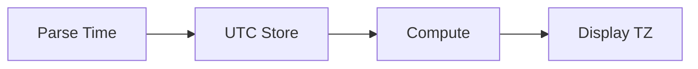

# Date and Time

## Overview

- **What is it?** Python's datetime module models dates, times, timestamps, and timedeltas.
- **Why is it important?** Scheduling, logging, billing, and analytics require correct temporal logic.
- **Where is it used?** Cron jobs, audit trails, SLAs, reporting windows.

## Learning Objectives

- **Skills gained:** Practical command of Date and Time.
- **Concepts covered:**

- Create datetime and timedelta objects.
- Format and parse ISO timestamps.
- Handle time zones with zoneinfo.

- **Expected outcome:** You perform reliable date/time calculations and formatting.

## Real World Applications

- Fintech settlement
- SaaS billing
- Log aggregation
- Travel booking

- **Business applications:** Automate workflows, reduce manual errors, accelerate delivery.
- **Career relevance:** Required knowledge for Python roles from junior developer to senior engineer.

## Core Concepts

### datetime

- **Definition:** Calendar date and clock time.
- **Visual explanation:** `datetime` → process → result
- **Practical example:**

```python
from datetime import datetime
print(datetime(2026, 6, 6).isoformat())
```

### timedelta

- **Definition:** Differences and durations.
- **Visual explanation:** `timedelta` → process → result
- **Practical example:**

```python
from datetime import timedelta
print(timedelta(days=7).days)
```

### timezone

- **Definition:** Aware UTC timestamps.
- **Visual explanation:** `timezone` → process → result
- **Practical example:**

```python
from datetime import datetime, timezone
print(datetime.now(timezone.utc).year)
```

## Infographic Summary

| Block | Summary |
| --- | --- |
| 📌 Concept | Use aware datetimes for distributed systems. |
| ⚡ Purpose | Measure, compare, and display time correctly. |
| 🔥 Benefits | Standard library support, ISO interoperability. |
| 🎯 Use Cases | Token expiry, report ranges, retry backoff. |
| 🚀 Best Practices | Store UTC; convert at display; use zoneinfo. |
| ❌ Common Mistakes | Naive vs aware mixing, DST bugs, parsing locale dates loosely. |

## Syntax Guide

### Basic Syntax

```python
from datetime import date
print(date.today())
```

### Standard Structure

```python
parse -> normalize TZ -> compute -> format
```

### Code Pattern

```python
deadline = start + timedelta(hours=24)
```

## Examples

### Beginner Example

```python
from datetime import datetime
print(datetime.now().year)
```

### Intermediate Example

```python
from datetime import datetime, timedelta
start = datetime(2026, 1, 1)
print((start + timedelta(days=30)).date())
```

### Advanced Example

```python
from datetime import datetime
from zoneinfo import ZoneInfo

utc = datetime(2026, 6, 6, 12, tzinfo=ZoneInfo('UTC'))
print(utc.astimezone(ZoneInfo('America/New_York')).hour)
```

## Workflow Diagram



---
