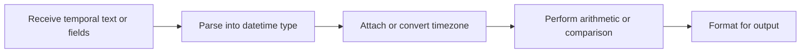

> **Level 1: Beginner** · Topic 28 of 35

[← Packages](./27-packages.md) · [↑ Level index](../README.md) · [Math Module →](./29-math-module.md)

# Date and Time

## Overview
- **What is it?** Python's `datetime` types represent calendar dates, clock times, combined datetimes, and durations.
- **Why is it important?** Explicit types support reliable arithmetic, formatting, parsing, and timezone-aware comparisons.
- **Where is it used?** Scheduling, deadlines, logs, billing periods, and data pipelines all process temporal values.

## Learning Objectives
- Create date, datetime, and timedelta objects.
- Parse and format values with ISO methods or format codes.
- Distinguish naive from timezone-aware datetimes.

## Real World Applications
- Calculate a due date.
- Parse timestamps from imported records.
- Compare events in a shared timezone.

## Core Concepts

### Calendar values
- **Definition:** `date` stores year, month, and day; `datetime` adds time fields.
- **Visual explanation:** `year month day + clock fields -> datetime`
- **Practical example:**

```python
from datetime import date
release = date(2026, 7, 20)
print(release.isoformat())
```

### Durations and arithmetic
- **Definition:** `timedelta` represents elapsed duration and can be added to or subtracted from dates and datetimes.
- **Visual explanation:** `start + duration -> end`
- **Practical example:**

```python
from datetime import date, timedelta
start = date(2026, 7, 20)
print(start + timedelta(days=14))
```

### Timezone awareness
- **Definition:** An aware datetime includes a `tzinfo` offset; comparing stored instants in UTC avoids local-time ambiguity.
- **Visual explanation:** `local aware time -> UTC -> compare or store`
- **Practical example:**

```python
from datetime import datetime, timezone
now_utc = datetime.now(timezone.utc)
print(now_utc.isoformat())
```

## Infographic Summary

| Infographic Block | Topic-Specific Takeaway |
| --- | --- |
| 📌 Concept | Python's `datetime` types represent calendar dates, clock times, combined datetimes, and durations. |
| ⚡ Purpose | Model calendar values, instants, and durations for temporal calculations. |
| 🔥 Benefits | Explicit types support reliable arithmetic, formatting, parsing, and timezone-aware comparisons. |
| 🎯 Use Cases | Scheduling, deadlines, logs, billing periods, and data pipelines all process temporal values. |
| 🚀 Best Practices | Use ISO 8601 at boundaries, timezone-aware UTC for instants, and `date` for calendar-only facts. |
| ❌ Common Mistakes | Mixing naive and aware datetimes or assuming a local clock reading uniquely identifies an instant. |

## Syntax Guide

### Basic Syntax

```python
from datetime import date
today = date.today()
print(today.year, today.month, today.day)
```

### Standard Structure

```python
from datetime import datetime
stamp = datetime.fromisoformat("2026-07-20T16:08:00")
print(stamp.strftime("%d %b %Y, %H:%M"))
```

### Code Pattern

```python
from datetime import datetime, timedelta, timezone
start = datetime(2026, 7, 20, 16, 0, tzinfo=timezone.utc)
deadline = start + timedelta(days=2, hours=6)
print(deadline.isoformat())
```

## Examples

### Beginner Example

```python
from datetime import date
birthday = date(2000, 5, 12)
print(birthday.strftime("%A"))
```

### Intermediate Example

```python
from datetime import date, timedelta
checkout = date(2026, 7, 20)
return_date = checkout + timedelta(weeks=3)
print(return_date.isoformat())
```

### Advanced Example

```python
from datetime import datetime, timezone

def parse_utc(text):
    parsed = datetime.fromisoformat(text)
    if parsed.tzinfo is None:
        raise ValueError("Timezone offset required")
    return parsed.astimezone(timezone.utc)

print(parse_utc("2026-07-20T18:08:00+02:00").isoformat())
```

## Workflow Diagram



---

[← Packages](./27-packages.md) · [↑ Level index](../README.md) · [Math Module →](./29-math-module.md)
