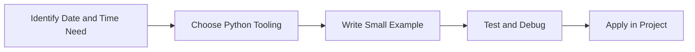

> **Level 1: Beginner** · Topic 28 of 35

[← Packages](./27-packages.md) · [↑ Level index](../README.md) · [Math Module →](./29-math-module.md)

# Date and Time

## Overview
- **What is it?** Date and time APIs model timestamps, durations, calendars, and time zones.
- **Why is it important?** Handle scheduling and time-based business rules correctly.
- **Where is it used?** Software teams, education, automation, analytics, and backend development.

## Learning Objectives
- Gain the practical skill to explain, write, debug, and review date and time code.
- Cover the vocabulary, syntax, workflow, edge cases, and professional habits behind date and time.
- Expected outcome: you can use date and time in a small project and recognize when it belongs in production code.

## Real World Applications
- **Industry use cases:** Software teams, education, automation, analytics, and backend development.
- **Business applications:** Reduce manual work, improve reliability, support reporting, automate decisions, and ship maintainable features.
- **Career relevance:** Supports Python developer, backend engineer, data engineer, AI engineer, DevOps engineer, QA automation, and cybersecurity automation roles.

## Core Concepts

### Mental Model
- **Definition:** The main idea that gives date and time its structure and purpose inside a Python program.
- **Visual explanation:** `problem -> Date and Time model -> clear code`
- **Practical example:**

```python
apply_date_and_time_label = "Date and Time"
print(apply_date_and_time_label)
```

### Execution Flow
- **Definition:** The ordered steps Python follows when date and time code is created, executed, or integrated.
- **Visual explanation:** `input -> Python operation -> result -> feedback`
- **Practical example:**

```python
from datetime import date
print(date.today())
```

### Quality Rule
- **Definition:** The reliability habit that keeps date and time understandable, testable, secure, and maintainable.
- **Visual explanation:** `working code -> validation -> production confidence`
- **Practical example:**

```python
from datetime import datetime, timedelta

due_at = datetime(2026, 7, 13) + timedelta(days=14)
print(due_at.date())
```

## Infographic Summary

| Infographic Block | Key Message |
| --- | --- |
| 📌 Concept | Date and Time belongs to the core programming foundation part of Python mastery. |
| ⚡ Purpose | Handle scheduling and time-based business rules correctly. |
| 🔥 Benefits | Reports, logs, billing, reminders, and audit trails. |
| 🎯 Use Cases | Software teams, education, automation, analytics, and backend development. |
| 🚀 Best Practices | Prefer readable names, small examples, explicit errors, tests, documentation, and version-aware choices. |
| ❌ Common Mistakes | Copying code without understanding it, ignoring edge cases, skipping validation, and mixing unrelated responsibilities. |

## Syntax Guide

### Basic Syntax

```python
from datetime import datetime, timezone
now = datetime.now(timezone.utc)
```

### Standard Structure

```python
def apply_date_and_time(value):
    """Apply the Date and Time concept to one value."""
    return value

result = apply_date_and_time("practice")
print(result)
```

### Code Pattern

```python
# 1. Identify the Date and Time problem
# 2. Apply the correct Python structure
# 3. Validate the result with tests or output
```

## Examples

### Beginner Example

```python
from datetime import date
print(date.today())
```

### Intermediate Example

```python
from datetime import datetime, timedelta

due_at = datetime(2026, 7, 13) + timedelta(days=14)
print(due_at.date())
```

### Advanced Example

```python
from datetime import datetime
from zoneinfo import ZoneInfo

meeting = datetime(2026, 7, 13, 9, tzinfo=ZoneInfo("UTC"))
print(meeting.astimezone(ZoneInfo("Asia/Dubai")))
```

## Workflow Diagram




---

---

[← Packages](./27-packages.md) · [↑ Level index](../README.md) · [Math Module →](./29-math-module.md)
