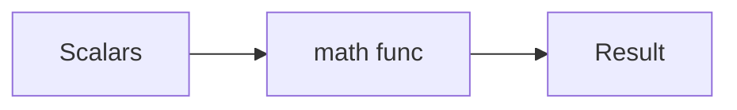

# Math Module

## Overview

- **What is it?** The math module provides standard mathematical functions and constants.
- **Why is it important?** It supplements built-in operators with trig, logs, rounding, and constants.
- **Where is it used?** Graphics, statistics, engineering, games, ML feature prep.

## Learning Objectives

- **Skills gained:** Practical command of Math Module.
- **Concepts covered:**

- Import and use math functions.
- Apply ceil, floor, sqrt, log.
- Know math vs numpy boundaries.

- **Expected outcome:** You perform common numeric operations with the math module.

## Real World Applications

- Simulation
- CAD tooling
- Quant finance
- Robotics

- **Business applications:** Automate workflows, reduce manual errors, accelerate delivery.
- **Career relevance:** Required knowledge for Python roles from junior developer to senior engineer.

## Core Concepts

### Constants

- **Definition:** pi and e.
- **Visual explanation:** `Constants` → process → result
- **Practical example:**

```python
import math
print(round(math.pi, 3))
```

### sqrt/log

- **Definition:** Roots and logarithms.
- **Visual explanation:** `sqrt/log` → process → result
- **Practical example:**

```python
import math
print(math.sqrt(16), math.log2(8))
```

### hypot

- **Definition:** Distance calculations.
- **Visual explanation:** `hypot` → process → result
- **Practical example:**

```python
import math
print(math.hypot(3, 4))
```

## Infographic Summary

| Block | Summary |
| --- | --- |
| 📌 Concept | math operates on scalars (not vectorized). |
| ⚡ Purpose | Accurate numeric primitives for algorithms. |
| 🔥 Benefits | Fast, standard, no extra dependency. |
| 🎯 Use Cases | Distance metrics, probability, geometry. |
| 🚀 Best Practices | Use math.isclose for floats; prefer decimal for money. |
| ❌ Common Mistakes | Using math on lists, domain errors on log/sqrt, float equality. |

## Syntax Guide

### Basic Syntax

```python
import math
print(math.pow(2, 3))
```

### Standard Structure

```python
import math -> compute scalar -> combine
```

### Code Pattern

```python
hyp = math.hypot(dx, dy)
```

## Examples

### Beginner Example

```python
import math
print(math.ceil(4.2))
```

### Intermediate Example

```python
import math
angles = [0, math.pi/2]
print([math.sin(a) for a in angles])
```

### Advanced Example

```python
import math

def sigmoid(x: float) -> float:
    return 1 / (1 + math.exp(-x))


print(round(sigmoid(0), 4))
```

## Workflow Diagram



---
