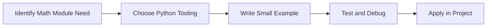

> **Level 1: Beginner** · Topic 29 of 35

[← Date and Time](./28-date-and-time.md) · [↑ Level index](../README.md) · [Random Module →](./30-random-module.md)

# Math Module

## Overview
- **What is it?** The math module provides numeric functions and constants.
- **Why is it important?** Perform reliable mathematical operations using the standard library.
- **Where is it used?** Software teams, education, automation, analytics, and backend development.

## Learning Objectives
- Gain the practical skill to explain, write, debug, and review math module code.
- Cover the vocabulary, syntax, workflow, edge cases, and professional habits behind math module.
- Expected outcome: you can use math module in a small project and recognize when it belongs in production code.

## Real World Applications
- **Industry use cases:** Software teams, education, automation, analytics, and backend development.
- **Business applications:** Reduce manual work, improve reliability, support reporting, automate decisions, and ship maintainable features.
- **Career relevance:** Supports Python developer, backend engineer, data engineer, AI engineer, DevOps engineer, QA automation, and cybersecurity automation roles.

## Core Concepts

### Mental Model
- **Definition:** The main idea that gives math module its structure and purpose inside a Python program.
- **Visual explanation:** `problem -> Math Module model -> clear code`
- **Practical example:**

```python
apply_math_module_label = "Math Module"
print(apply_math_module_label)
```

### Execution Flow
- **Definition:** The ordered steps Python follows when math module code is created, executed, or integrated.
- **Visual explanation:** `input -> Python operation -> result -> feedback`
- **Practical example:**

```python
import math
print(math.pi)
```

### Quality Rule
- **Definition:** The reliability habit that keeps math module understandable, testable, secure, and maintainable.
- **Visual explanation:** `working code -> validation -> production confidence`
- **Practical example:**

```python
import math

radius = 5
area = math.pi * math.pow(radius, 2)
print(round(area, 2))
```

## Infographic Summary

| Infographic Block | Key Message |
| --- | --- |
| 📌 Concept | Math Module belongs to the core programming foundation part of Python mastery. |
| ⚡ Purpose | Perform reliable mathematical operations using the standard library. |
| 🔥 Benefits | Finance, analytics, geometry, science, and simulations. |
| 🎯 Use Cases | Software teams, education, automation, analytics, and backend development. |
| 🚀 Best Practices | Prefer readable names, small examples, explicit errors, tests, documentation, and version-aware choices. |
| ❌ Common Mistakes | Copying code without understanding it, ignoring edge cases, skipping validation, and mixing unrelated responsibilities. |

## Syntax Guide

### Basic Syntax

```python
import math
print(math.sqrt(81))
```

### Standard Structure

```python
def apply_math_module(value):
    """Apply the Math Module concept to one value."""
    return value

result = apply_math_module("practice")
print(result)
```

### Code Pattern

```python
# 1. Identify the Math Module problem
# 2. Apply the correct Python structure
# 3. Validate the result with tests or output
```

## Examples

### Beginner Example

```python
import math
print(math.pi)
```

### Intermediate Example

```python
import math

radius = 5
area = math.pi * math.pow(radius, 2)
print(round(area, 2))
```

### Advanced Example

```python
import statistics

latencies = [120, 95, 140, 110]
print(statistics.mean(latencies), statistics.pstdev(latencies))
```

## Workflow Diagram




---

---

[← Date and Time](./28-date-and-time.md) · [↑ Level index](../README.md) · [Random Module →](./30-random-module.md)
