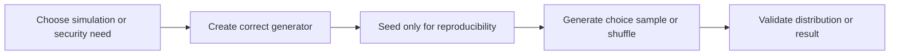

> **Level 1: Beginner** · Topic 30 of 35

[← Math Module](./29-math-module.md) · [↑ Level index](../README.md) · [File Handling →](./31-file-handling.md)

# Random Module

## Overview
- **What is it?** The `random` module produces deterministic pseudo-random sequences suitable for simulation, sampling, and games.
- **Why is it important?** It offers controlled variation and reproducibility through explicit random generator instances and seeds.
- **Where is it used?** Games, randomized tests, classroom exercises, and statistical samples use pseudo-random values.

## Learning Objectives
- Generate ranges, choices, samples, and shuffled sequences.
- Use a local `Random` instance with a seed for repeatable tests.
- Avoid `random` for passwords, tokens, or security decisions.

## Real World Applications
- Roll dice or select a game move.
- Sample records without replacement.
- Create repeatable test fixtures and simulations.

## Core Concepts

### Pseudo-random generator
- **Definition:** A generator evolves deterministic internal state, so the same seed produces the same sequence.
- **Visual explanation:** `seed + state -> next value -> updated state`
- **Practical example:**

```python
import random
rng = random.Random(7)
print(rng.randint(1, 6), rng.randint(1, 6))
```

### Choice and sampling
- **Definition:** `choice` picks one element; `sample` returns distinct selections without replacement.
- **Visual explanation:** `population -> random index or distinct indexes -> selection`
- **Practical example:**

```python
import random
rng = random.Random(3)
colors = ["red", "green", "blue", "gold"]
print(rng.choice(colors), rng.sample(colors, k=2))
```

### Security boundary
- **Definition:** The algorithm is predictable and must not generate credentials; the `secrets` module serves security-sensitive choices.
- **Visual explanation:** `simulation -> random; secret token -> secrets`
- **Practical example:**

```python
import secrets
alphabet = "ABCDEFGHJKLMNPQRSTUVWXYZ23456789"
code = "".join(secrets.choice(alphabet) for _ in range(8))
print(len(code))
```

## Infographic Summary

| Infographic Block | Topic-Specific Takeaway |
| --- | --- |
| 📌 Concept | The `random` module produces deterministic pseudo-random sequences suitable for simulation, sampling, and games. |
| ⚡ Purpose | Generate controlled pseudo-random choices, samples, and simulations. |
| 🔥 Benefits | It offers controlled variation and reproducibility through explicit random generator instances and seeds. |
| 🎯 Use Cases | Games, randomized tests, classroom exercises, and statistical samples use pseudo-random values. |
| 🚀 Best Practices | Inject or create a seeded generator for tests, omit the seed for ordinary simulation, and use `secrets` for security. |
| ❌ Common Mistakes | Seeding globally in production code or using `random` to create reset tokens and passwords. |

## Syntax Guide

### Basic Syntax

```python
import random
print(random.randint(1, 6))
```

### Standard Structure

```python
import random
rng = random.Random(42)
participants = ["Ada", "Bo", "Chen", "Dia"]
print(rng.sample(participants, k=2))
```

### Code Pattern

```python
import random
rng = random.Random(10)
results = {"heads": 0, "tails": 0}
for _ in range(1000):
    side = rng.choice(list(results))
    results[side] += 1
print(results)
```

## Examples

### Beginner Example

```python
import random
print(random.choice(["north", "south", "east", "west"]))
```

### Intermediate Example

```python
import random
rng = random.Random(5)
deck = list(range(1, 11))
rng.shuffle(deck)
hand = deck[:3]
print(hand)
```

### Advanced Example

```python
import random

def estimate_even_probability(trials, seed):
    rng = random.Random(seed)
    even = 0
    for _ in range(trials):
        even += rng.randint(1, 6) % 2 == 0
    return even / trials

print(estimate_even_probability(10_000, 11))
```

## Workflow Diagram



---

[← Math Module](./29-math-module.md) · [↑ Level index](../README.md) · [File Handling →](./31-file-handling.md)
