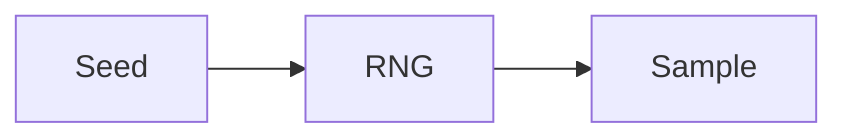

# Random Module

## Overview

- **What is it?** The random module generates pseudo-random numbers and samples for simulations.
- **Why is it important?** Games, sampling, shuffling, and Monte Carlo methods need controlled randomness.
- **Where is it used?** A/B tests, load balancing, procedural content, QA fuzzing.

## Learning Objectives

- **Skills gained:** Practical command of Random Module.
- **Concepts covered:**

- Use random, randint, choice, shuffle.
- Seed RNG for reproducibility.
- Choose secrets vs random correctly.

- **Expected outcome:** You generate randomness safely for simulations and sampling.

## Real World Applications

- Gaming
- ML data splits
- Security training
- Load testing

- **Business applications:** Automate workflows, reduce manual errors, accelerate delivery.
- **Career relevance:** Required knowledge for Python roles from junior developer to senior engineer.

## Core Concepts

### randint

- **Definition:** Random integer in range.
- **Visual explanation:** `randint` → process → result
- **Practical example:**

```python
import random
print(random.randint(1, 6))
```

### choice

- **Definition:** Pick random element.
- **Visual explanation:** `choice` → process → result
- **Practical example:**

```python
import random
print(random.choice(['red', 'blue']))
```

### seed

- **Definition:** Reproducible sequences.
- **Visual explanation:** `seed` → process → result
- **Practical example:**

```python
import random
random.seed(0)
print(random.random())
```

## Infographic Summary

| Block | Summary |
| --- | --- |
| 📌 Concept | random is deterministic given a seed. |
| ⚡ Purpose | Simulate uncertainty and shuffle data. |
| 🔥 Benefits | Simple API, reproducible tests with seed. |
| 🎯 Use Cases | Dice rolls, train/test split, lottery draws. |
| 🚀 Best Practices | Use secrets module for crypto; seed in tests only. |
| ❌ Common Mistakes | Using random for passwords, biased sampling, forgetting seed in tests. |

## Syntax Guide

### Basic Syntax

```python
import random
print(random.random())
```

### Standard Structure

```python
seed (optional) -> draw -> use
```

### Code Pattern

```python
sample = random.sample(population, k=3)
```

## Examples

### Beginner Example

```python
import random
print(random.choice(['A', 'B', 'C']))
```

### Intermediate Example

```python
import random
items = [1, 2, 3, 4]
random.shuffle(items)
print(items)
```

### Advanced Example

```python
import random

def bootstrap(data: list[float], n: int) -> list[float]:
    return [random.choice(data) for _ in range(n)]


print(bootstrap([1.0, 2.0, 3.0], 5))
```

## Workflow Diagram



---
