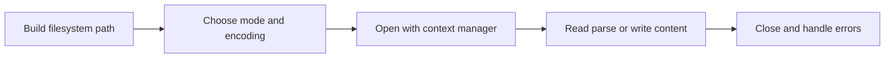

> **Level 1: Beginner** · Topic 31 of 35

[← Random Module](./30-random-module.md) · [↑ Level index](../README.md) · [Exception Handling →](./32-exception-handling.md)

# File Handling

## Overview
- **What is it?** File handling opens filesystem paths and reads or writes persistent bytes or text.
- **Why is it important?** Context managers close resources reliably, while explicit modes and encodings make data behavior predictable.
- **Where is it used?** Applications store configuration, reports, logs, exports, and imported datasets in files.

## Learning Objectives
- Open text files with a context manager and explicit encoding.
- Choose read, write, append, or exclusive-creation modes.
- Use `pathlib` and handle missing or malformed content.

## Real World Applications
- Read application settings.
- Write a generated report.
- Append events to a log or process a file line by line.

## Core Concepts

### Paths and modes
- **Definition:** A path identifies a filesystem entry; mode `r`, `w`, `a`, or `x` determines read, replace, append, or create-only behavior.
- **Visual explanation:** `path + mode -> open file object`
- **Practical example:**

```python
from pathlib import Path
path = Path("notes.txt")
print(path.name, path.suffix)
```

### Context-managed resource
- **Definition:** A `with` statement closes the file even when an exception leaves the block.
- **Visual explanation:** `with open -> use resource -> automatic close`
- **Practical example:**

```python
from io import StringIO
with StringIO("first\nsecond\n") as file:
    print(file.readline().strip())
```

### Text encoding and structure
- **Definition:** Text must be encoded as bytes on disk; specifying UTF-8 avoids platform-dependent defaults.
- **Visual explanation:** `Unicode text <-> UTF-8 bytes <-> file`
- **Practical example:**

```python
from pathlib import Path
path = Path("lesson_demo.txt")
path.write_text("Python ✓\n", encoding="utf-8")
print(path.read_text(encoding="utf-8").strip())
path.unlink()
```

## Infographic Summary

| Infographic Block | Topic-Specific Takeaway |
| --- | --- |
| 📌 Concept | File handling opens filesystem paths and reads or writes persistent bytes or text. |
| ⚡ Purpose | Read and write persistent text or bytes through safely managed file resources. |
| 🔥 Benefits | Context managers close resources reliably, while explicit modes and encodings make data behavior predictable. |
| 🎯 Use Cases | Applications store configuration, reports, logs, exports, and imported datasets in files. |
| 🚀 Best Practices | Use `Path`, `with`, and `encoding='utf-8'`; write to a temporary path before replacing valuable data. |
| ❌ Common Mistakes | Using write mode on an existing file without realizing it truncates all previous content. |

## Syntax Guide

### Basic Syntax

```python
from io import StringIO
file = StringIO("alpha\nbeta\n")
print(file.read())
file.close()
```

### Standard Structure

```python
from pathlib import Path
path = Path("example.txt")
path.write_text("one\ntwo\n", encoding="utf-8")
lines = path.read_text(encoding="utf-8").splitlines()
print(lines)
path.unlink()
```

### Code Pattern

```python
from pathlib import Path
import json

path = Path("settings_demo.json")
data = {"theme": "dark", "font_size": 14}
path.write_text(json.dumps(data, indent=2), encoding="utf-8")
loaded = json.loads(path.read_text(encoding="utf-8"))
print(loaded["theme"])
path.unlink()
```

## Examples

### Beginner Example

```python
from io import StringIO
with StringIO("Python file practice") as file:
    print(file.read())
```

### Intermediate Example

```python
from pathlib import Path
path = Path("scores_demo.txt")
path.write_text("80\n92\n76\n", encoding="utf-8")
scores = [int(line) for line in path.read_text(encoding="utf-8").splitlines()]
print(sum(scores) / len(scores))
path.unlink()
```

### Advanced Example

```python
from pathlib import Path
import csv

path = Path("people_demo.csv")
with path.open("w", newline="", encoding="utf-8") as file:
    writer = csv.DictWriter(file, fieldnames=["name", "score"])
    writer.writeheader()
    writer.writerows([{"name": "Ada", "score": 90}, {"name": "Bo", "score": 84}])
with path.open(newline="", encoding="utf-8") as file:
    records = list(csv.DictReader(file))
print(records)
path.unlink()
```

## Workflow Diagram



---

[← Random Module](./30-random-module.md) · [↑ Level index](../README.md) · [Exception Handling →](./32-exception-handling.md)
