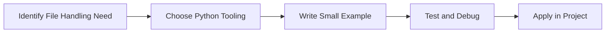

> **Level 1: Beginner** · Topic 31 of 35

[← Random Module](./30-random-module.md) · [↑ Level index](../README.md) · [Exception Handling →](./32-exception-handling.md)

# File Handling

## Overview
- **What is it?** File handling reads, writes, appends, and manages files safely.
- **Why is it important?** Persist and exchange data outside program memory.
- **Where is it used?** Software teams, education, automation, analytics, and backend development.

## Learning Objectives
- Gain the practical skill to explain, write, debug, and review file handling code.
- Cover the vocabulary, syntax, workflow, edge cases, and professional habits behind file handling.
- Expected outcome: you can use file handling in a small project and recognize when it belongs in production code.

## Real World Applications
- **Industry use cases:** Software teams, education, automation, analytics, and backend development.
- **Business applications:** Reduce manual work, improve reliability, support reporting, automate decisions, and ship maintainable features.
- **Career relevance:** Supports Python developer, backend engineer, data engineer, AI engineer, DevOps engineer, QA automation, and cybersecurity automation roles.

## Core Concepts

### Mental Model
- **Definition:** The main idea that gives file handling its structure and purpose inside a Python program.
- **Visual explanation:** `problem -> File Handling model -> clear code`
- **Practical example:**

```python
apply_file_handling_label = "File Handling"
print(apply_file_handling_label)
```

### Execution Flow
- **Definition:** The ordered steps Python follows when file handling code is created, executed, or integrated.
- **Visual explanation:** `input -> Python operation -> result -> feedback`
- **Practical example:**

```python
from pathlib import Path
Path("hello.txt").write_text("Hello file", encoding="utf-8")
print(Path("hello.txt").read_text(encoding="utf-8"))
```

### Quality Rule
- **Definition:** The reliability habit that keeps file handling understandable, testable, secure, and maintainable.
- **Visual explanation:** `working code -> validation -> production confidence`
- **Practical example:**

```python
from pathlib import Path

rows = ["name,score", "Ada,95"]
Path("scores.csv").write_text("\n".join(rows), encoding="utf-8")
```

## Infographic Summary

| Infographic Block | Key Message |
| --- | --- |
| 📌 Concept | File Handling belongs to the core programming foundation part of Python mastery. |
| ⚡ Purpose | Persist and exchange data outside program memory. |
| 🔥 Benefits | Logs, CSV imports, reports, configs, and backups. |
| 🎯 Use Cases | Software teams, education, automation, analytics, and backend development. |
| 🚀 Best Practices | Prefer readable names, small examples, explicit errors, tests, documentation, and version-aware choices. |
| ❌ Common Mistakes | Copying code without understanding it, ignoring edge cases, skipping validation, and mixing unrelated responsibilities. |

## Syntax Guide

### Basic Syntax

```python
from pathlib import Path
Path("notes.txt").write_text("hello", encoding="utf-8")
```

### Standard Structure

```python
def apply_file_handling(value):
    """Apply the File Handling concept to one value."""
    return value

result = apply_file_handling("practice")
print(result)
```

### Code Pattern

```python
# 1. Identify the File Handling problem
# 2. Apply the correct Python structure
# 3. Validate the result with tests or output
```

## Examples

### Beginner Example

```python
from pathlib import Path
Path("hello.txt").write_text("Hello file", encoding="utf-8")
print(Path("hello.txt").read_text(encoding="utf-8"))
```

### Intermediate Example

```python
from pathlib import Path

rows = ["name,score", "Ada,95"]
Path("scores.csv").write_text("\n".join(rows), encoding="utf-8")
```

### Advanced Example

```python
from pathlib import Path
import json

config = {"debug": False, "retries": 3}
Path("config.json").write_text(json.dumps(config, indent=2), encoding="utf-8")
```

## Workflow Diagram




---

---

[← Random Module](./30-random-module.md) · [↑ Level index](../README.md) · [Exception Handling →](./32-exception-handling.md)
