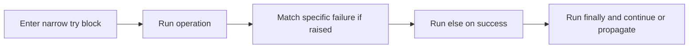

> **Level 1: Beginner** · Topic 32 of 35

[← File Handling](./31-file-handling.md) · [↑ Level index](../README.md) · [Debugging Basics →](./33-debugging-basics.md)

# Exception Handling

## Overview
- **What is it?** Exception handling uses `try`, `except`, `else`, `finally`, and `raise` to represent and respond to runtime failures.
- **Why is it important?** It separates expected failure paths from normal logic without silently hiding programming defects.
- **Where is it used?** Input conversion, file access, networking, and domain validation can all raise exceptions.

## Learning Objectives
- Catch specific exception types.
- Use `else` for success work and `finally` for unconditional cleanup.
- Raise meaningful exceptions and preserve useful error context.

## Real World Applications
- Reject malformed user data.
- Recover from a missing optional file.
- Translate low-level failures into domain-specific messages.

## Core Concepts

### Raising and propagation
- **Definition:** When an exception is raised, normal execution stops and stack frames unwind until a matching handler is found.
- **Visual explanation:** `raise -> unwind call stack -> matching except or program exit`
- **Practical example:**

```python
def require_positive(value):
    if value <= 0:
        raise ValueError("value must be positive")
    return value

print(require_positive(3))
```

### Specific handlers
- **Definition:** An `except` clause should catch only failures it can meaningfully handle.
- **Visual explanation:** `try operation -> matching exception -> recovery`
- **Practical example:**

```python
try:
    count = int("not-a-number")
except ValueError as error:
    print(f"Invalid count: {error}")
```

### Else and finally
- **Definition:** `else` runs only after a successful try; `finally` runs whether the operation succeeded or failed.
- **Visual explanation:** `try -> success else or failure except -> always finally`
- **Practical example:**

```python
events = []
try:
    value = 10 / 2
except ZeroDivisionError:
    events.append("failed")
else:
    events.append(f"result={value}")
finally:
    events.append("finished")
print(events)
```

## Infographic Summary

| Infographic Block | Topic-Specific Takeaway |
| --- | --- |
| 📌 Concept | Exception handling uses `try`, `except`, `else`, `finally`, and `raise` to represent and respond to runtime failures. |
| ⚡ Purpose | Represent expected runtime failures and route them to appropriate recovery logic. |
| 🔥 Benefits | It separates expected failure paths from normal logic without silently hiding programming defects. |
| 🎯 Use Cases | Input conversion, file access, networking, and domain validation can all raise exceptions. |
| 🚀 Best Practices | Keep try blocks narrow, catch named exceptions, and either recover clearly or let the error propagate. |
| ❌ Common Mistakes | Using a bare `except` that hides interrupts, programming bugs, and the original cause. |

## Syntax Guide

### Basic Syntax

```python
try:
    number = int("42")
except ValueError:
    print("Invalid number")
else:
    print(number)
```

### Standard Structure

```python
def safe_divide(left, right):
    try:
        return left / right
    except ZeroDivisionError:
        return None
print(safe_divide(8, 2), safe_divide(8, 0))
```

### Code Pattern

```python
class InvalidScoreError(ValueError):
    pass
def record_score(value):
    if not 0 <= value <= 100:
        raise InvalidScoreError(f"score out of range: {value}")
    return {"score": value}
try:
    print(record_score(120))
except InvalidScoreError as error:
    print(error)
```

## Examples

### Beginner Example

```python
try:
    result = 5 / 0
except ZeroDivisionError:
    result = None
print(result)
```

### Intermediate Example

```python
def parse_age(text):
    try:
        age = int(text)
    except ValueError as error:
        raise ValueError("age must be a whole number") from error
    if age < 0:
        raise ValueError("age cannot be negative")
    return age
print(parse_age("21"))
```

### Advanced Example

```python
def load_port(settings):
    try:
        raw = settings["port"]
        port = int(raw)
    except KeyError:
        return 8000
    except ValueError as error:
        raise ValueError("configured port must be numeric") from error
    else:
        if not 1 <= port <= 65535:
            raise ValueError("port outside valid range")
        return port
print(load_port({"port": "8080"}))
```

## Workflow Diagram



---

[← File Handling](./31-file-handling.md) · [↑ Level index](../README.md) · [Debugging Basics →](./33-debugging-basics.md)
