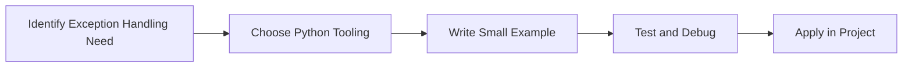

> **Level 1: Beginner** · Topic 32 of 35

[← File Handling](./31-file-handling.md) · [↑ Level index](../README.md) · [Debugging Basics →](./33-debugging-basics.md)

# Exception Handling

## Overview
- **What is it?** Exception handling catches and responds to runtime failures.
- **Why is it important?** Keep programs understandable and resilient when things go wrong.
- **Where is it used?** Software teams, education, automation, analytics, and backend development.

## Learning Objectives
- Gain the practical skill to explain, write, debug, and review exception handling code.
- Cover the vocabulary, syntax, workflow, edge cases, and professional habits behind exception handling.
- Expected outcome: you can use exception handling in a small project and recognize when it belongs in production code.

## Real World Applications
- **Industry use cases:** Software teams, education, automation, analytics, and backend development.
- **Business applications:** Reduce manual work, improve reliability, support reporting, automate decisions, and ship maintainable features.
- **Career relevance:** Supports Python developer, backend engineer, data engineer, AI engineer, DevOps engineer, QA automation, and cybersecurity automation roles.

## Core Concepts

### Mental Model
- **Definition:** The main idea that gives exception handling its structure and purpose inside a Python program.
- **Visual explanation:** `problem -> Exception Handling model -> clear code`
- **Practical example:**

```python
apply_exception_handling_label = "Exception Handling"
print(apply_exception_handling_label)
```

### Execution Flow
- **Definition:** The ordered steps Python follows when exception handling code is created, executed, or integrated.
- **Visual explanation:** `input -> Python operation -> result -> feedback`
- **Practical example:**

```python
try:
    print(10 / 0)
except ZeroDivisionError:
    print("Cannot divide by zero")
```

### Quality Rule
- **Definition:** The reliability habit that keeps exception handling understandable, testable, secure, and maintainable.
- **Visual explanation:** `working code -> validation -> production confidence`
- **Practical example:**

```python
def parse_quantity(raw: str) -> int:
    try:
        return int(raw)
    except ValueError as exc:
        raise ValueError(f"Invalid quantity: {raw}") from exc

print(parse_quantity("12"))
```

## Infographic Summary

| Infographic Block | Key Message |
| --- | --- |
| 📌 Concept | Exception Handling belongs to the core programming foundation part of Python mastery. |
| ⚡ Purpose | Keep programs understandable and resilient when things go wrong. |
| 🔥 Benefits | API clients, validation, file IO, retries, and user-friendly errors. |
| 🎯 Use Cases | Software teams, education, automation, analytics, and backend development. |
| 🚀 Best Practices | Prefer readable names, small examples, explicit errors, tests, documentation, and version-aware choices. |
| ❌ Common Mistakes | Copying code without understanding it, ignoring edge cases, skipping validation, and mixing unrelated responsibilities. |

## Syntax Guide

### Basic Syntax

```python
try:
    value = int(raw_value)
except ValueError:
    value = 0
```

### Standard Structure

```python
def apply_exception_handling(value):
    """Apply the Exception Handling concept to one value."""
    return value

result = apply_exception_handling("practice")
print(result)
```

### Code Pattern

```python
# 1. Identify the Exception Handling problem
# 2. Apply the correct Python structure
# 3. Validate the result with tests or output
```

## Examples

### Beginner Example

```python
try:
    print(10 / 0)
except ZeroDivisionError:
    print("Cannot divide by zero")
```

### Intermediate Example

```python
def parse_quantity(raw: str) -> int:
    try:
        return int(raw)
    except ValueError as exc:
        raise ValueError(f"Invalid quantity: {raw}") from exc

print(parse_quantity("12"))
```

### Advanced Example

```python
class PaymentError(Exception):
    pass

def charge(amount: float) -> str:
    if amount <= 0:
        raise PaymentError("Amount must be positive")
    return "approved"

print(charge(10))
```

## Workflow Diagram




---

---

[← File Handling](./31-file-handling.md) · [↑ Level index](../README.md) · [Debugging Basics →](./33-debugging-basics.md)
