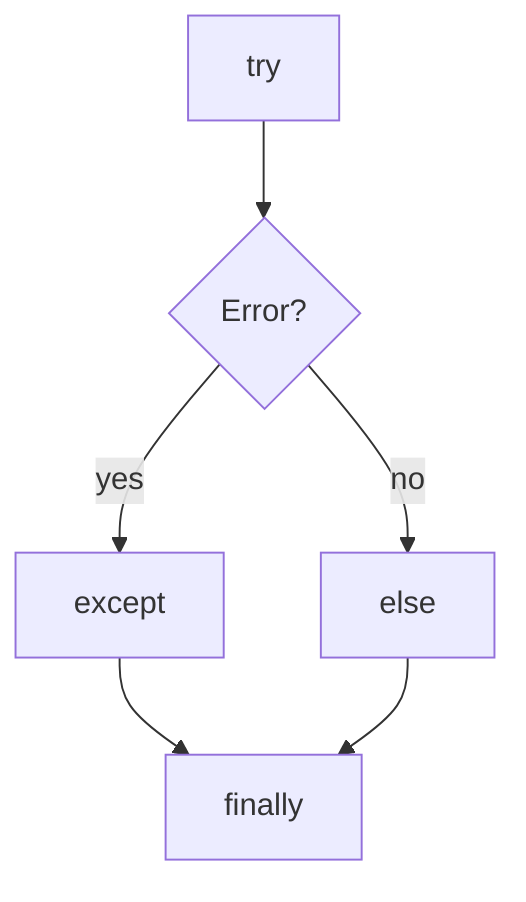

# Exception Handling

## Overview

- **What is it?** Exception handling manages errors with try, except, else, and finally.
- **Why is it important?** Robust programs recover from failures and preserve resources.
- **Where is it used?** Network I/O, parsing, databases, user input.

## Learning Objectives

- **Skills gained:** Practical command of Exception Handling.
- **Concepts covered:**

- Catch specific exceptions.
- Raise meaningful errors.
- Use finally for cleanup.

- **Expected outcome:** You write fault-tolerant code with clear error paths.

## Real World Applications

- Payment processing
- API gateways
- Data ingestion
- Desktop apps

- **Business applications:** Automate workflows, reduce manual errors, accelerate delivery.
- **Career relevance:** Required knowledge for Python roles from junior developer to senior engineer.

## Core Concepts

### try/except

- **Definition:** Handle expected failures.
- **Visual explanation:** `try/except` → process → result
- **Practical example:**

```python
try:
    int('x')
except ValueError as e:
    print(type(e).__name__)
```

### raise

- **Definition:** Signal errors upstream.
- **Visual explanation:** `raise` → process → result
- **Practical example:**

```python
def require_positive(n):
    if n <= 0:
        raise ValueError('must be positive')
require_positive(1)
```

### finally

- **Definition:** Always-run cleanup.
- **Visual explanation:** `finally` → process → result
- **Practical example:**

```python
f = None
try:
    f = open(__file__)
    data = f.read(10)
finally:
    if f:
        f.close()
print(len(data))
```

## Infographic Summary

| Block | Summary |
| --- | --- |
| 📌 Concept | Exceptions unwind the stack until a matching handler runs. |
| ⚡ Purpose | Separate happy path from error recovery. |
| 🔥 Benefits | Resource safety, clearer control flow, rich tracebacks. |
| 🎯 Use Cases | Retry wrappers, validation, transaction rollback. |
| 🚀 Best Practices | Catch specific types; chain exceptions; log context. |
| ❌ Common Mistakes | Bare except, swallowing errors, using exceptions for flow control. |

## Syntax Guide

### Basic Syntax

```python
try:
    risky()
except Exception:
    handle()
```

### Standard Structure

```python
try -> except specific -> else -> finally
```

### Code Pattern

```python
try:
    return parse(data)
except ParseError:
    return default
```

## Examples

### Beginner Example

```python
try:
    print(1 / 0)
except ZeroDivisionError:
    print('cannot divide by zero')
```

### Intermediate Example

```python
class AppError(Exception):
    pass


def load(value: str) -> int:
    try:
        return int(value)
    except ValueError as exc:
        raise AppError('bad input') from exc


print(load('10'))
```

### Advanced Example

```python
from contextlib import suppress

with suppress(FileNotFoundError):
    open('missing.txt').read()
print('continued')
```

## Workflow Diagram



---
