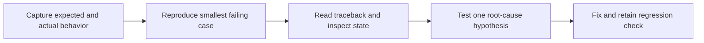

> **Level 1: Beginner** · Topic 33 of 35

[← Exception Handling](./32-exception-handling.md) · [↑ Level index](../README.md) · [Virtual Environments →](./34-virtual-environments.md)

# Debugging Basics

## Overview
- **What is it?** Debugging is an evidence-driven process for reproducing, locating, explaining, fixing, and preventing defects.
- **Why is it important?** A disciplined workflow replaces guesses with observations from tracebacks, tests, logging, and debugger state.
- **Where is it used?** Every development role debugs incorrect results, exceptions, integrations, and environment differences.

## Learning Objectives
- Reproduce a defect with the smallest reliable input.
- Read a traceback from the final exception upward through relevant frames.
- Form a hypothesis, inspect state, apply one fix, and add a regression check.

## Real World Applications
- Find an off-by-one calculation.
- Trace malformed data to its source.
- Compare expected and actual state at a breakpoint.

## Core Concepts

### Reliable reproduction
- **Definition:** A reproducible case records the input, environment, steps, expected result, and actual result.
- **Visual explanation:** `known setup + input -> repeatable failure`
- **Practical example:**

```python
def last_item(items):
    return items[-1]

sample = ["a", "b"]
print(last_item(sample))
```

### Tracebacks and state
- **Definition:** A traceback identifies exception type, message, and active call frames; inspected values explain how execution reached the failure.
- **Visual explanation:** `exception -> traceback frames -> relevant variables`
- **Practical example:**

```python
def ratio(total, count):
    return total / count

# Run this failing case, then read the final exception and its call frame:
print(ratio(12, 0))  # ZeroDivisionError points back to the division above.
```

### Hypothesis and regression
- **Definition:** Change one suspected cause, rerun the reproduction, then preserve the case as an automated assertion.
- **Visual explanation:** `failure -> hypothesis -> focused fix -> regression test`
- **Practical example:**

```python
def inclusive_count(start, stop):
    return stop - start + 1

assert inclusive_count(3, 5) == 3
print("Regression check passed")
```

## Infographic Summary

| Infographic Block | Topic-Specific Takeaway |
| --- | --- |
| 📌 Concept | Debugging is an evidence-driven process for reproducing, locating, explaining, fixing, and preventing defects. |
| ⚡ Purpose | Locate and explain a defect through reproducible evidence before correcting it. |
| 🔥 Benefits | A disciplined workflow replaces guesses with observations from tracebacks, tests, logging, and debugger state. |
| 🎯 Use Cases | Every development role debugs incorrect results, exceptions, integrations, and environment differences. |
| 🚀 Best Practices | Record expected versus actual behavior, inspect values near the first wrong state, and keep a test for every fixed bug. |
| ❌ Common Mistakes | Changing several lines before reproducing the bug, making it impossible to know which change mattered. |

## Syntax Guide

### Basic Syntax

```python
values = [2, 4, 6]
print("count:", len(values), "values:", values)
```

### Standard Structure

```python
def average(total, count):
    print(f"DEBUG {total=} {count=}")
    return total / count

result = average(18, 3)
assert result == 6
```

### Code Pattern

```python
def calculate_discount(price, percent):
    if not 0 <= percent <= 100:
        raise ValueError("percent must be from 0 to 100")
    return price * (1 - percent / 100)

cases = [(100, 20, 80), (50, 0, 50), (50, 100, 0)]
for price, percent, expected in cases:
    actual = calculate_discount(price, percent)
    assert actual == expected, (price, percent, expected, actual)
print("All regression cases passed")
```

## Examples

### Beginner Example

```python
expected = 10
actual = 4 + 6
print({"expected": expected, "actual": actual})
assert actual == expected
```

### Intermediate Example

```python
def lookup(items, index):
    breakpoint()  # Inspect items and index, then enter "continue".
    return items[index]

assert lookup(["a", "b", "c"], 2) == "c"
```

### Advanced Example

```python
def calculate_pages(total_items, page_size):
    if page_size <= 0:
        raise ValueError("page_size must be positive")
    return (total_items + page_size - 1) // page_size

tests = [(0, 10, 0), (1, 10, 1), (10, 10, 1), (11, 10, 2)]
for total, size, expected in tests:
    actual = calculate_pages(total, size)
    assert actual == expected, f"{total=}, {size=}, {actual=}"
print("Pagination regression tests passed")
```

## Workflow Diagram



---

[← Exception Handling](./32-exception-handling.md) · [↑ Level index](../README.md) · [Virtual Environments →](./34-virtual-environments.md)
