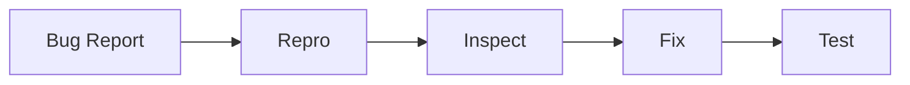

# Debugging Basics

## Overview

- **What is it?** Debugging basics include reading tracebacks, using print/logging, and breakpoints.
- **Why is it important?** Finding root cause quickly saves hours in development and incidents.
- **Where is it used?** Local dev, staging reproduction, postmortems.

## Learning Objectives

- **Skills gained:** Practical command of Debugging Basics.
- **Concepts covered:**

- Read stack traces bottom-up.
- Use pdb/breakpoint().
- Form hypotheses and isolate bugs.

- **Expected outcome:** You systematically narrow down and fix defects.

## Real World Applications

- SRE
- QA automation
- Game dev
- Enterprise apps

- **Business applications:** Automate workflows, reduce manual errors, accelerate delivery.
- **Career relevance:** Required knowledge for Python roles from junior developer to senior engineer.

## Core Concepts

### Traceback

- **Definition:** Shows call stack at error.
- **Visual explanation:** `Traceback` → process → result
- **Practical example:**

```python
import traceback
try:
    1/0
except ZeroDivisionError:
    traceback.print_exc()
```

### breakpoint

- **Definition:** Interactive debugger entry.
- **Visual explanation:** `breakpoint` → process → result
- **Practical example:**

```python
x = 1
x += 1
print(x)
```

### logging

- **Definition:** Better than print in prod.
- **Visual explanation:** `logging` → process → result
- **Practical example:**

```python
import logging
logging.basicConfig(level=logging.INFO)
logging.info('check')
```

## Infographic Summary

| Block | Summary |
| --- | --- |
| 📌 Concept | Debug loop: reproduce -> isolate -> fix -> verify. |
| ⚡ Purpose | Restore correct program behavior. |
| 🔥 Benefits | Faster fixes, fewer regressions, shared techniques. |
| 🎯 Use Cases | Failing tests, prod incidents, flaky jobs. |
| 🚀 Best Practices | Minimal repro, binary search commits, watch variables. |
| ❌ Common Mistakes | Random changes, ignoring traceback, debugging without tests. |

## Syntax Guide

### Basic Syntax

```python
import logging
logging.debug('state=%s', value)
```

### Standard Structure

```python
reproduce -> inspect -> hypothesize -> fix -> test
```

### Code Pattern

```python
assert expected == actual, (expected, actual)
```

## Examples

### Beginner Example

```python
def add(a, b):
    return a + b
assert add(2, 3) == 5
```

### Intermediate Example

```python
def divide(a, b):
    try:
        return a / b
    except ZeroDivisionError:
        return float('inf')


print(divide(1, 0))
```

### Advanced Example

```python
import logging

logger = logging.getLogger(__name__)


def compute(values):
    logger.debug('inputs=%r', values)
    return sum(values)


print(compute([1, 2, 3]))
```

## Workflow Diagram



---
