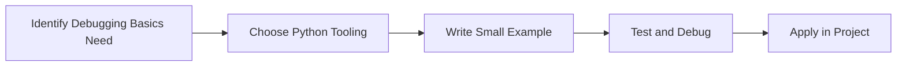

> **Level 1: Beginner** · Topic 33 of 35

[← Exception Handling](./32-exception-handling.md) · [↑ Level index](../README.md) · [Virtual Environments →](./34-virtual-environments.md)

# Debugging Basics

## Overview
- **What is it?** Debugging is the process of finding, understanding, and fixing defects.
- **Why is it important?** Use evidence instead of guesses when code behaves unexpectedly.
- **Where is it used?** Software teams, education, automation, analytics, and backend development.

## Learning Objectives
- Gain the practical skill to explain, write, debug, and review debugging basics code.
- Cover the vocabulary, syntax, workflow, edge cases, and professional habits behind debugging basics.
- Expected outcome: you can use debugging basics in a small project and recognize when it belongs in production code.

## Real World Applications
- **Industry use cases:** Software teams, education, automation, analytics, and backend development.
- **Business applications:** Reduce manual work, improve reliability, support reporting, automate decisions, and ship maintainable features.
- **Career relevance:** Supports Python developer, backend engineer, data engineer, AI engineer, DevOps engineer, QA automation, and cybersecurity automation roles.

## Core Concepts

### Mental Model
- **Definition:** The main idea that gives debugging basics its structure and purpose inside a Python program.
- **Visual explanation:** `problem -> Debugging Basics model -> clear code`
- **Practical example:**

```python
apply_debugging_basics_label = "Debugging Basics"
print(apply_debugging_basics_label)
```

### Execution Flow
- **Definition:** The ordered steps Python follows when debugging basics code is created, executed, or integrated.
- **Visual explanation:** `input -> Python operation -> result -> feedback`
- **Practical example:**

```python
topic = "Debugging Basics"
print(f"Learning {topic}")
```

### Quality Rule
- **Definition:** The reliability habit that keeps debugging basics understandable, testable, secure, and maintainable.
- **Visual explanation:** `working code -> validation -> production confidence`
- **Practical example:**

```python
def summarize_debugging_basics(items: list[str]) -> dict[str, int]:
    return {"topic_count": len(items), "unique_count": len(set(items))}

print(summarize_debugging_basics(["learn", "practice", "learn"]))
```

## Infographic Summary

| Infographic Block | Key Message |
| --- | --- |
| 📌 Concept | Debugging Basics belongs to the core programming foundation part of Python mastery. |
| ⚡ Purpose | Use evidence instead of guesses when code behaves unexpectedly. |
| 🔥 Benefits | Faster issue resolution, better tests, and reliable delivery. |
| 🎯 Use Cases | Software teams, education, automation, analytics, and backend development. |
| 🚀 Best Practices | Prefer readable names, small examples, explicit errors, tests, documentation, and version-aware choices. |
| ❌ Common Mistakes | Copying code without understanding it, ignoring edge cases, skipping validation, and mixing unrelated responsibilities. |

## Syntax Guide

### Basic Syntax

```python
topic_name = "Debugging Basics"
print(topic_name)
```

### Standard Structure

```python
def apply_debugging_basics(value):
    """Apply the Debugging Basics concept to one value."""
    return value

result = apply_debugging_basics("practice")
print(result)
```

### Code Pattern

```python
# 1. Identify the Debugging Basics problem
# 2. Apply the correct Python structure
# 3. Validate the result with tests or output
```

## Examples

### Beginner Example

```python
topic = "Debugging Basics"
print(f"Learning {topic}")
```

### Intermediate Example

```python
def summarize_debugging_basics(items: list[str]) -> dict[str, int]:
    return {"topic_count": len(items), "unique_count": len(set(items))}

print(summarize_debugging_basics(["learn", "practice", "learn"]))
```

### Advanced Example

```python
from dataclasses import dataclass

@dataclass(frozen=True)
class DebuggingBasicsOutcome:
    topic: str
    evidence: str

outcome = DebuggingBasicsOutcome("Debugging Basics", "production-ready understanding")
print(outcome)
```

## Workflow Diagram




---

---

[← Exception Handling](./32-exception-handling.md) · [↑ Level index](../README.md) · [Virtual Environments →](./34-virtual-environments.md)
