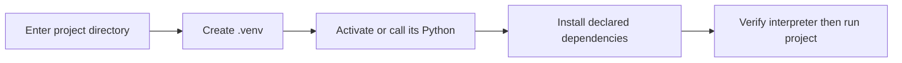

> **Level 1: Beginner** · Topic 34 of 35

[← Debugging Basics](./33-debugging-basics.md) · [↑ Level index](../README.md) · [Basic Project Structure →](./35-basic-project-structure.md)

# Virtual Environments

## Overview
- **What is it?** A virtual environment is an isolated Python installation context with its own interpreter links and site-packages directory.
- **Why is it important?** Isolation lets projects use different dependency versions without modifying system Python.
- **Where is it used?** Local development, CI jobs, tutorials, and deployments create environments from declared dependencies.

## Learning Objectives
- Create and activate a `.venv` with the standard `venv` module.
- Install packages through the environment's Python and verify the active executable.
- Record dependencies while excluding the environment directory from version control.

## Real World Applications
- Keep two projects on incompatible library versions.
- Reproduce a teammate's dependency set.
- Run tests in a clean environment.

## Core Concepts

### Environment creation
- **Definition:** `python -m venv .venv` creates an environment directory containing a Python executable and package location.
- **Visual explanation:** `base interpreter -> venv -> isolated interpreter context`
- **Practical example:**

```python
import venv
print(venv.EnvBuilder.__module__)
```

### Activation and interpreter identity
- **Definition:** Activation prepends the environment's executable directory to `PATH`; it is convenience, not a requirement.
- **Visual explanation:** `activate -> PATH changed -> python resolves inside .venv`
- **Practical example:**

```python
import sys
print(sys.prefix)
print(sys.base_prefix)
print("in venv:", sys.prefix != sys.base_prefix)
```

### Dependency workflow
- **Definition:** Packages installed with `environment-python -m pip` belong to that environment; a dependency file describes what to recreate.
- **Visual explanation:** `dependency declaration -> clean venv -> install -> verify`
- **Practical example:**

```python
import importlib.metadata
pip_version = importlib.metadata.version("pip")
print(f"pip {pip_version}")
```

## Infographic Summary

| Infographic Block | Topic-Specific Takeaway |
| --- | --- |
| 📌 Concept | A virtual environment is an isolated Python installation context with its own interpreter links and site-packages directory. |
| ⚡ Purpose | Isolate each project's interpreter context and installed dependencies. |
| 🔥 Benefits | Isolation lets projects use different dependency versions without modifying system Python. |
| 🎯 Use Cases | Local development, CI jobs, tutorials, and deployments create environments from declared dependencies. |
| 🚀 Best Practices | Create `.venv` per project, use `python -m pip`, commit dependency declarations, and never commit the environment directory. |
| ❌ Common Mistakes | Assuming activation installs dependencies or makes an environment portable between machines. |

## Syntax Guide

### Basic Syntax

```python
import sys
print(sys.executable)
print(sys.prefix != sys.base_prefix)
```

### Standard Structure

```python
import site
import sys
print({"environment": sys.prefix, "packages": site.getsitepackages()})
```

### Code Pattern

```python
import importlib.metadata
import sys

packages = sorted(
    (dist.metadata["Name"], dist.version)
    for dist in importlib.metadata.distributions()
    if dist.metadata["Name"]
)
print({"python": sys.version.split()[0], "package_count": len(packages)})
print(packages[:3])
```

### Terminal Workflow

```bash
python -m venv .venv
source .venv/bin/activate          # macOS or Linux
# .venv\Scripts\activate           # Windows PowerShell
python -m pip install -r requirements.txt
python -c "import sys; print(sys.executable)"
deactivate
```

## Examples

### Beginner Example

```python
import sys
print("Virtual environment active:", sys.prefix != sys.base_prefix)
```

### Intermediate Example

```python
from pathlib import Path
import sys
venv_root = Path(sys.prefix)
print({"root": venv_root.name, "python": Path(sys.executable).name})
```

### Advanced Example

```python
import importlib.metadata
import sys

def environment_report():
    distributions = list(importlib.metadata.distributions())
    return {
        "python": sys.version.split()[0],
        "isolated": sys.prefix != sys.base_prefix,
        "installed_distributions": len(distributions),
    }

print(environment_report())
```

## Workflow Diagram



---

[← Debugging Basics](./33-debugging-basics.md) · [↑ Level index](../README.md) · [Basic Project Structure →](./35-basic-project-structure.md)
