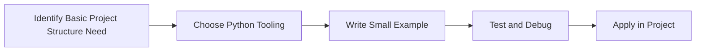

> **Level 1: Beginner** · Topic 35 of 35

[← Virtual Environments](./34-virtual-environments.md) · [↑ Level index](../README.md)

# Basic Project Structure

## Overview
- **What is it?** Basic project structure organizes source code, tests, docs, and configuration into predictable folders.
- **Why is it important?** Make projects easier to navigate, test, and maintain.
- **Where is it used?** Software teams, education, automation, analytics, and backend development.

## Learning Objectives
- Gain the practical skill to explain, write, debug, and review basic project structure code.
- Cover the vocabulary, syntax, workflow, edge cases, and professional habits behind basic project structure.
- Expected outcome: you can use basic project structure in a small project and recognize when it belongs in production code.

## Real World Applications
- **Industry use cases:** Software teams, education, automation, analytics, and backend development.
- **Business applications:** Reduce manual work, improve reliability, support reporting, automate decisions, and ship maintainable features.
- **Career relevance:** Supports Python developer, backend engineer, data engineer, AI engineer, DevOps engineer, QA automation, and cybersecurity automation roles.

## Core Concepts

### Mental Model
- **Definition:** The main idea that gives basic project structure its structure and purpose inside a Python program.
- **Visual explanation:** `problem -> Basic Project Structure model -> clear code`
- **Practical example:**

```python
apply_basic_project_structure_label = "Basic Project Structure"
print(apply_basic_project_structure_label)
```

### Execution Flow
- **Definition:** The ordered steps Python follows when basic project structure code is created, executed, or integrated.
- **Visual explanation:** `input -> Python operation -> result -> feedback`
- **Practical example:**

```python
message = "Run this file from your IDE"
print(message)
```

### Quality Rule
- **Definition:** The reliability habit that keeps basic project structure understandable, testable, secure, and maintainable.
- **Visual explanation:** `working code -> validation -> production confidence`
- **Practical example:**

```python
def format_name(first: str, last: str) -> str:
    return f"{first.title()} {last.title()}"

print(format_name("ada", "lovelace"))
```

## Infographic Summary

| Infographic Block | Key Message |
| --- | --- |
| 📌 Concept | Basic Project Structure belongs to the core programming foundation part of Python mastery. |
| ⚡ Purpose | Make projects easier to navigate, test, and maintain. |
| 🔥 Benefits | Team collaboration, onboarding, packaging, and scaling. |
| 🎯 Use Cases | Software teams, education, automation, analytics, and backend development. |
| 🚀 Best Practices | Prefer readable names, small examples, explicit errors, tests, documentation, and version-aware choices. |
| ❌ Common Mistakes | Copying code without understanding it, ignoring edge cases, skipping validation, and mixing unrelated responsibilities. |

## Syntax Guide

### Basic Syntax

```python
def add(left: int, right: int) -> int:
    return left + right

print(add(2, 3))
```

### Standard Structure

```python
def apply_basic_project_structure(value):
    """Apply the Basic Project Structure concept to one value."""
    return value

result = apply_basic_project_structure("practice")
print(result)
```

### Code Pattern

```python
# 1. Identify the Basic Project Structure problem
# 2. Apply the correct Python structure
# 3. Validate the result with tests or output
```

## Examples

### Beginner Example

```python
message = "Run this file from your IDE"
print(message)
```

### Intermediate Example

```python
def format_name(first: str, last: str) -> str:
    return f"{first.title()} {last.title()}"

print(format_name("ada", "lovelace"))
```

### Advanced Example

```python
import pdb

values = [1, 2, 3]
total = sum(values)
# pdb.set_trace()
print(total)
```

## Workflow Diagram




---

---

## Level 2: Intermediate

Develop professional engineering habits for larger projects, integration work, testing, and maintainability.

---

[← Virtual Environments](./34-virtual-environments.md) · [↑ Level index](../README.md)
