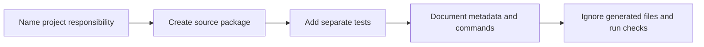

> **Level 1: Beginner** · Topic 35 of 35

[← Virtual Environments](./34-virtual-environments.md) · [↑ Level index](../README.md)

# Basic Project Structure

## Overview
- **What is it?** Basic project structure gives source code, tests, configuration, documentation, and generated files predictable locations.
- **Why is it important?** A clear layout makes imports, commands, collaboration, testing, and packaging easier to understand.
- **Where is it used?** Even small scripts benefit when they grow into maintained applications or reusable packages.

## Learning Objectives
- Separate importable source from tests and project documentation.
- Add an entry point guarded by `__name__ == '__main__'`.
- Keep generated environments, caches, secrets, and build output out of version control.

## Real World Applications
- Onboard contributors with an obvious starting point.
- Run tests against importable application code.
- Package or deploy without mixing source and local artifacts.

## Core Concepts

### Source and test boundaries
- **Definition:** Application modules belong in a package, while tests import and exercise that package from a separate directory.
- **Visual explanation:** `project -> src package + tests`
- **Practical example:**

```python
from pathlib import PurePath
source = PurePath("src") / "academy" / "courses.py"
test = PurePath("tests") / "test_courses.py"
print(source, test)
```

### Project metadata
- **Definition:** `pyproject.toml` can describe build settings, project metadata, dependencies, and tool configuration.
- **Visual explanation:** `pyproject.toml -> tools and build backend`
- **Practical example:**

```python
from pathlib import PurePath
files = [PurePath("pyproject.toml"), PurePath("README.md"), PurePath(".gitignore")]
print([file.name for file in files])
```

### Entry point and clean repository
- **Definition:** A small entry module calls application functions; ignored runtime artifacts remain outside the tracked source tree.
- **Visual explanation:** `command -> entry point -> package logic; artifacts -> ignored`
- **Practical example:**

```python
def main():
    print("Academy application")

if __name__ == "__main__":
    main()
```

## Infographic Summary

| Infographic Block | Topic-Specific Takeaway |
| --- | --- |
| 📌 Concept | Basic project structure gives source code, tests, configuration, documentation, and generated files predictable locations. |
| ⚡ Purpose | Give source, tests, metadata, documentation, and generated artifacts clear locations. |
| 🔥 Benefits | A clear layout makes imports, commands, collaboration, testing, and packaging easier to understand. |
| 🎯 Use Cases | Even small scripts benefit when they grow into maintained applications or reusable packages. |
| 🚀 Best Practices | Start with the smallest structure that separates source and tests, document the run command, and ignore generated artifacts. |
| ❌ Common Mistakes | Creating many empty architectural folders before the project has responsibilities that justify them. |

## Syntax Guide

### Basic Syntax

```python
from pathlib import PurePath
project_files = [PurePath("README.md"), PurePath("app.py"), PurePath("tests/test_app.py")]
for file in project_files:
    print(file)
```

### Standard Structure

```python
def project_tree(name):
    return [
        f"{name}/README.md",
        f"{name}/src/{name}/__init__.py",
        f"{name}/tests/test_core.py",
        f"{name}/pyproject.toml",
    ]

print(*project_tree("academy"), sep="\n")
```

### Code Pattern

```python
from pathlib import PurePath

def classify(path_text):
    path = PurePath(path_text)
    if "tests" in path.parts:
        return "test"
    if "src" in path.parts:
        return "source"
    if path.name.startswith("."):
        return "configuration"
    return "project metadata"

for item in ["src/academy/core.py", "tests/test_core.py", ".gitignore", "README.md"]:
    print(item, "->", classify(item))
```

## Examples

### Beginner Example

```python
from pathlib import PurePath
root = PurePath("academy")
print(root / "README.md")
```

### Intermediate Example

```python
from pathlib import PurePath
paths = {
    "source": PurePath("src/academy"),
    "tests": PurePath("tests"),
    "metadata": PurePath("pyproject.toml"),
}
for role, path in paths.items():
    print(role, path)
```

### Advanced Example

```python
from pathlib import PurePath

def validate_layout(paths):
    parts = {PurePath(path).parts[0] for path in paths}
    required = {"src", "tests"}
    return {"missing": sorted(required - parts), "valid": required <= parts}

layout = ["src/academy/__init__.py", "src/academy/cli.py", "tests/test_cli.py"]
print(validate_layout(layout))
```

## Workflow Diagram



---

[← Virtual Environments](./34-virtual-environments.md) · [↑ Level index](../README.md)
