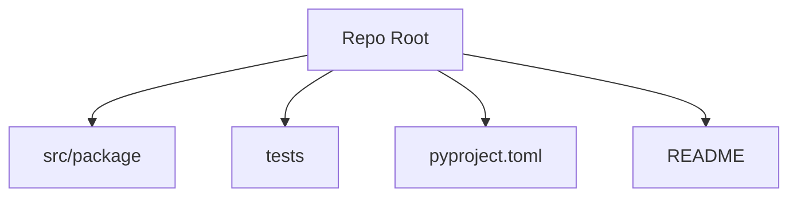

# Basic Project Structure

## Overview

- **What is it?** Basic project structure organizes source, tests, config, and docs for maintainability.
- **Why is it important?** Consistent layout helps teams navigate, test, and package code.
- **Where is it used?** Every repo from tutorials to production services.

## Learning Objectives

- **Skills gained:** Practical command of Basic Project Structure.
- **Concepts covered:**

- Lay out src/ or package root with tests.
- Add README, requirements, and .gitignore.
- Use pyproject.toml for modern tooling.

- **Expected outcome:** You bootstrap Python projects that scale beyond one file.

## Real World Applications

- Open source
- Agencies
- Product engineering
- Research labs

- **Business applications:** Automate workflows, reduce manual errors, accelerate delivery.
- **Career relevance:** Required knowledge for Python roles from junior developer to senior engineer.

## Core Concepts

### src layout

- **Definition:** Package under src/ avoids import confusion.
- **Visual explanation:** `src layout` → process → result
- **Practical example:**

```python
from pathlib import Path
print(Path('scripts').is_dir())
```

### tests/

- **Definition:** Automated verification.
- **Visual explanation:** `tests/` → process → result
- **Practical example:**

```python
import pathlib
print(pathlib.Path('scripts').exists())
```

### pyproject.toml

- **Definition:** Project metadata and tools.
- **Visual explanation:** `pyproject.toml` → process → result
- **Practical example:**

```python
print('pyproject'[:3])
```

## Infographic Summary

| Block | Summary |
| --- | --- |
| 📌 Concept | Structure communicates boundaries and entry points. |
| ⚡ Purpose | Enable testing, packaging, and collaboration. |
| 🔥 Benefits | Onboarding speed, CI clarity, fewer import hacks. |
| 🎯 Use Cases | CLI tools, libraries, microservices. |
| 🚀 Best Practices | One obvious README; Makefile/task runner optional; pin Python version. |
| ❌ Common Mistakes | Flat script pile, tests not runnable, secrets in repo. |

## Syntax Guide

### Basic Syntax

```python
from pathlib import Path
print(list(Path('.').glob('scripts/*.py'))[:1])
```

### Standard Structure

```python
README + pyproject + package + tests + scripts
```

### Code Pattern

```python
layout = {'src': 'pkg', 'tests': 'tests', 'config': 'pyproject.toml'}
print(layout['src'])
```

## Examples

### Beginner Example

```python
from pathlib import Path
print([p.name for p in Path('scripts').glob('*.py')][:3])
```

### Intermediate Example

```python
from pathlib import Path
root = Path('.')
print('has scripts:', (root / 'scripts').exists())
print('has README:', (root / 'README.md').exists())
```

### Advanced Example

```python
from pathlib import Path

def tree(path: Path, prefix: str = '') -> None:
    entries = sorted(path.iterdir(), key=lambda p: p.name)
    for entry in entries[:5]:
        print(prefix + entry.name)


tree(Path('scripts'))
```

## Workflow Diagram



---
