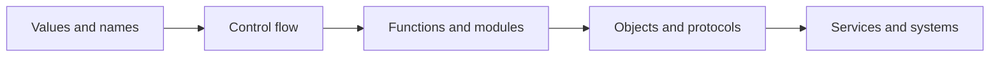

# Python Glossary

[← Knowledge base](../README.md) · [Beginner checkpoint](../Assessments/01-beginner-checkpoint.md)

Short, precise definitions for terms used across the 110 lessons. Open the linked lesson when you need examples, syntax, and a workflow diagram.

## Foundations

| Term | Definition | Lesson |
| --- | --- | --- |
| Interpreter | The program that reads Python source and executes it. | [Introduction to Python](../Beginner/01-introduction-to-python.md) |
| REPL | A read-eval-print loop for trying statements interactively. | [Installing Python](../Beginner/02-installing-python.md) |
| Syntax | The grammar that decides which source text is a valid program. | [Python Syntax](../Beginner/04-python-syntax.md) |
| Variable | A name bound to an object in a namespace. | [Variables](../Beginner/05-variables.md) |
| Data type | The kind of value an object represents, such as `int`, `str`, or `list`. | [Data Types](../Beginner/06-data-types.md) |
| Type casting | Explicit conversion from one type to another, such as `int("12")`. | [Type Casting](../Beginner/07-type-casting.md) |
| Operator | A symbol or keyword that combines values, such as `+`, `==`, or `in`. | [Operators](../Beginner/09-operators.md) |
| Truthiness | The Boolean interpretation of a value in a condition. Empty collections and `0` are false. | [Conditional Statements](../Beginner/10-conditional-statements.md) |
| Iterable | An object that can produce items one by one, such as a list, string, or generator. | [Loops](../Beginner/11-loops.md) |
| String | An immutable sequence of characters. | [Strings](../Beginner/14-strings.md) |
| List | An ordered, mutable sequence. | [Lists](../Beginner/16-lists.md) |
| Tuple | An ordered, immutable sequence, often used for fixed records. | [Tuples](../Beginner/18-tuples.md) |
| Set | An unordered collection of unique hashable items. | [Sets](../Beginner/19-sets.md) |
| Dictionary | A mapping from hashable keys to values. | [Dictionaries](../Beginner/20-dictionaries.md) |
| Function | A reusable block of code defined with `def` or `lambda`. | [Functions](../Beginner/21-functions.md) |
| Parameter | A name in a function definition that receives an argument. | [Arguments and Parameters](../Beginner/22-arguments-and-parameters.md) |
| Argument | A value passed to a function at call time. | [Arguments and Parameters](../Beginner/22-arguments-and-parameters.md) |
| Return value | The object a function hands back with `return`. Functions without `return` yield `None`. | [Return Statements](../Beginner/23-return-statements.md) |
| Scope | The region where a name is visible: local, enclosing, global, or built-in. | [Scope](../Beginner/24-scope.md) |
| Lambda | A single-expression anonymous function. | [Lambda Functions](../Beginner/25-lambda-functions.md) |
| Module | A `.py` file that can be imported. | [Modules](../Beginner/26-modules.md) |
| Package | A directory of modules, typically with `__init__.py`. | [Packages](../Beginner/27-packages.md) |
| Virtual environment | An isolated directory of a Python interpreter and installed packages. | [Virtual Environments](../Beginner/34-virtual-environments.md) |
| Exception | An object raised to signal a failure that callers can catch. | [Exception Handling](../Beginner/32-exception-handling.md) |
| Traceback | The stack report Python prints when an exception is unhandled. | [Debugging Basics](../Beginner/33-debugging-basics.md) |

## Engineering

| Term | Definition | Lesson |
| --- | --- | --- |
| Class | A blueprint that defines attributes and methods for objects. | [Classes](../Intermediate/02-classes.md) |
| Object | A concrete instance that holds state and behavior. | [Objects](../Intermediate/03-objects.md) |
| Constructor | `__init__`, which initializes a new instance after it is created. | [Constructors](../Intermediate/04-constructors.md) |
| Encapsulation | Hiding internal state behind a deliberate public interface. | [Encapsulation](../Intermediate/05-encapsulation.md) |
| Inheritance | A subclass reusing and extending a parent class. | [Inheritance](../Intermediate/06-inheritance.md) |
| Polymorphism | Different types responding to the same operation in their own way. | [Polymorphism](../Intermediate/07-polymorphism.md) |
| Abstraction | Exposing essential behavior while hiding implementation detail. | [Abstraction](../Intermediate/08-abstraction.md) |
| Magic method | A dunder method such as `__str__` or `__iter__` that hooks into Python syntax. | [Magic Methods](../Intermediate/09-magic-methods.md) |
| Iterator | An object with `__next__` that yields items until `StopIteration`. | [Iterators](../Intermediate/10-iterators.md) |
| Generator | A function that uses `yield` and returns a lazy iterator. | [Generators](../Intermediate/11-generators.md) |
| Decorator | A callable that wraps another callable to add behavior. | [Decorators](../Intermediate/12-decorators.md) |
| Context manager | An object that implements `__enter__` and `__exit__`, usually used with `with`. | [Context Managers](../Intermediate/13-context-managers.md) |
| Regular expression | A pattern language for searching and extracting text. | [Regular Expressions](../Intermediate/14-regular-expressions.md) |
| JSON | A text format for objects, arrays, strings, numbers, booleans, and null. | [JSON Processing](../Intermediate/15-json-processing.md) |
| Logging | Structured, level-based diagnostic output intended for operators. | [Logging](../Intermediate/18-logging.md) |
| Thread | A lightweight flow of execution that shares memory with other threads. | [Multithreading](../Intermediate/20-multithreading.md) |
| Process | An isolated execution environment with its own memory. | [Multiprocessing](../Intermediate/21-multiprocessing.md) |
| Async task | A coroutine scheduled on an event loop to overlap waiting work. | [Async Programming](../Intermediate/22-async-programming.md) |
| API | A contract for how clients request and receive behavior, often over HTTP. | [API Development](../Intermediate/23-api-development.md) |
| ORM | A library that maps Python objects to relational rows and queries. | [SQLAlchemy ORM](../Intermediate/30-sqlalchemy-orm.md) |
| Unit test | An automated check of one behavior with dependencies replaced or isolated. | [Unit Testing](../Intermediate/31-unit-testing.md) |
| Mock | A test double that records calls and supplies controlled return values. | [Mocking](../Intermediate/33-mocking.md) |

## Systems

| Term | Definition | Lesson |
| --- | --- | --- |
| GIL | CPython's global interpreter lock, which allows one thread to run Python bytecode at a time. | [Concurrency](../Advanced/10-concurrency.md) |
| Descriptor | An object with `__get__`, `__set__`, or `__delete__` that customizes attribute access. | [Descriptors](../Advanced/09-descriptors.md) |
| Metaclass | The class of a class, used when class creation itself must be customized. | [Metaclasses](../Advanced/08-metaclasses.md) |
| Garbage collection | Reclaiming objects that are no longer reachable, including cyclic references. | [Garbage Collection](../Advanced/06-garbage-collection.md) |
| Idempotency | Repeating an operation does not create extra business effects. | [ETL Development](../Advanced/18-etl-development.md) |
| ETL | Extract, transform, and load: moving data through a reliable pipeline. | [Data Engineering](../Advanced/19-data-engineering.md) |
| Microservice | A small service that owns one business capability and a clear API. | [Microservices](../Advanced/30-microservices.md) |
| Container image | A packaged filesystem and start command that runs the same way on each host. | [Docker with Python](../Advanced/31-docker-with-python.md) |
| CI/CD | Automated build, test, and release steps triggered by a change. | [CI/CD Pipelines](../Advanced/38-ci-cd-pipelines.md) |
| Least privilege | Granting only the permissions a task needs, and nothing broader. | [Cybersecurity Automation](../Advanced/15-cybersecurity-automation.md) |

## Related study tools

| Tool | Use it for |
| --- | --- |
| [Cheat sheets](../CheatSheets/) | Syntax you want to recall quickly |
| [Checkpoint assessments](../Assessments/) | Checking whether a level has stuck |
| [Interview questions](../Interview-Questions/) | Explaining tradeoffs out loud |
| [Project briefs](../Projects/) | Turning vocabulary into a working artifact |
