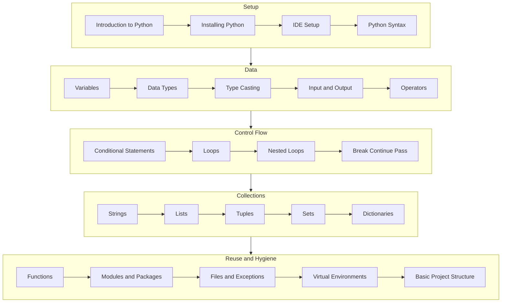

# Level 1 Beginner Infographic Map

[← Infographics](./README.md) · [Beginner lessons](../Beginner/01-introduction-to-python.md)

## Overview

Beginner Python is the path from installing an interpreter to writing small, reliable scripts. The map below groups the 35 lessons into five visual clusters so learners can see how syntax, data, control flow, reuse, and project hygiene connect.

## Infographic Summary

| Infographic Block | Topic-Specific Takeaway |
| --- | --- |
| 📌 Concept | A Python program binds names to values, then uses operators, branches, loops, and functions to produce results. |
| ⚡ Purpose | Give beginners a complete mental model before they write larger applications. |
| 🔥 Benefits | Fast feedback, readable code, and a foundation that every career path reuses. |
| 🎯 Use Cases | Calculators, file processors, quizzes, reports, and first CLI utilities. |
| 🚀 Best Practices | Run every example, change one input, and keep project files inside a virtual environment. |
| ❌ Common Mistakes | Skipping types, mutating while iterating, catching all exceptions, and mixing global state. |

## Cluster Map

## Study Path

| Cluster | Lessons | Outcome |
| --- | --- | --- |
| Setup | Introduction, install, IDE, syntax | Run Python from the terminal |
| Data | Variables, types, casting, IO, operators | Model facts and calculations |
| Control | Conditions, loops, nested loops, break/continue/pass | Direct program decisions |
| Collections | Strings, lists, tuples, sets, dictionaries | Choose the right container |
| Reuse | Functions, modules, files, venv, project layout | Ship a small maintainable script |
