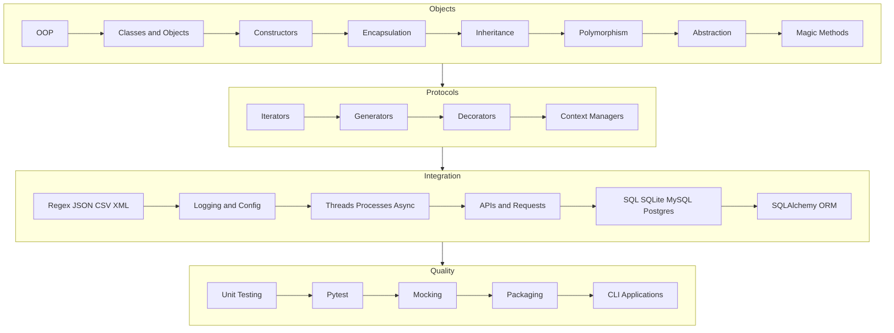

# Level 2 Intermediate Infographic Map

[← Infographics](./README.md) · [Intermediate lessons](../Intermediate/01-object-oriented-programming.md)

## Overview

Intermediate Python turns scripts into maintainable applications. Objects, protocols, data formats, concurrency, APIs, databases, tests, and packaging are the professional toolkit.

## Infographic Summary

| Infographic Block | Topic-Specific Takeaway |
| --- | --- |
| 📌 Concept | Professional Python organizes behavior behind objects, protocols, and tested interfaces. |
| ⚡ Purpose | Move from working scripts to applications other people can run, extend, and operate. |
| 🔥 Benefits | Clear boundaries, safer integrations, and evidence from automated tests. |
| 🎯 Use Cases | CLIs, REST clients, CRUD services, data parsers, and installable libraries. |
| 🚀 Best Practices | Prefer composition, validate at edges, log without secrets, and mock only true boundaries. |
| ❌ Common Mistakes | God classes, shared mutable state across threads, string-built SQL, and untested happy paths only. |

## Cluster Map

## Study Path

| Cluster | Lessons | Outcome |
| --- | --- | --- |
| Objects | OOP through magic methods | Model a domain with validated state |
| Protocols | Iterators, generators, decorators, context managers | Compose reusable language hooks |
| Integration | Formats, logging, concurrency, APIs, databases | Connect systems safely |
| Quality | unittest, pytest, mocking, packaging, CLIs | Ship an installable, tested tool |
