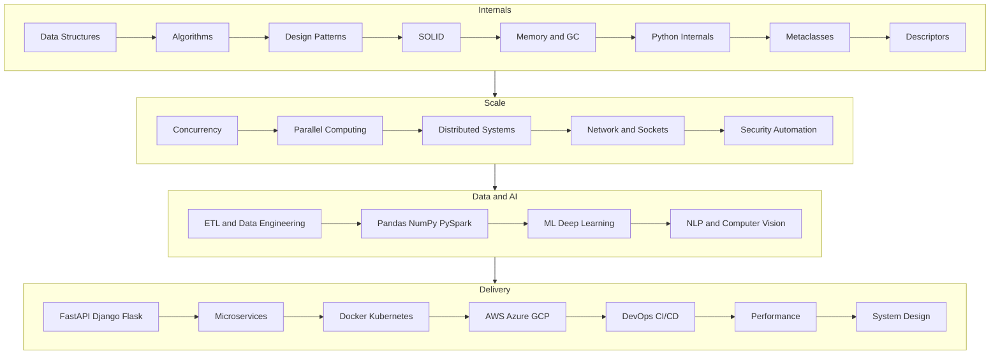

# Level 3 Advanced Infographic Map

[← Infographics](./README.md) · [Advanced lessons](../Advanced/01-data-structures-internals.md)

## Overview

Advanced Python is production engineering: internals, architecture, data and AI stacks, web frameworks, cloud, DevOps, security, and system design. Specialization comes after shared foundations.

## Infographic Summary

| Infographic Block | Topic-Specific Takeaway |
| --- | --- |
| 📌 Concept | Production Python combines language internals, architecture, and operational discipline. |
| ⚡ Purpose | Design systems that stay correct under load, failure, and change. |
| 🔥 Benefits | Predictable performance, safer deployments, and career-aligned specialization. |
| 🎯 Use Cases | High-throughput APIs, ETL platforms, ML serving, cloud automation, and security tooling. |
| 🚀 Best Practices | Measure before optimizing, isolate failure domains, and keep secrets out of images. |
| ❌ Common Mistakes | Premature microservices, unbounded concurrency, treating Docker as a security boundary, and unversioned models. |

## Cluster Map

## Study Path

| Cluster | Lessons | Outcome |
| --- | --- | --- |
| Internals | Structures, algorithms, patterns, SOLID, memory, metaclasses, descriptors | Reason about CPython behavior |
| Scale | Concurrency, parallelism, distributed systems, networking, security | Handle load and failure |
| Data and AI | ETL, Pandas, NumPy, Spark, ML, NLP, vision | Build data and model pipelines |
| Delivery | Frameworks, containers, cloud, DevOps, performance, system design | Ship and operate production services |
