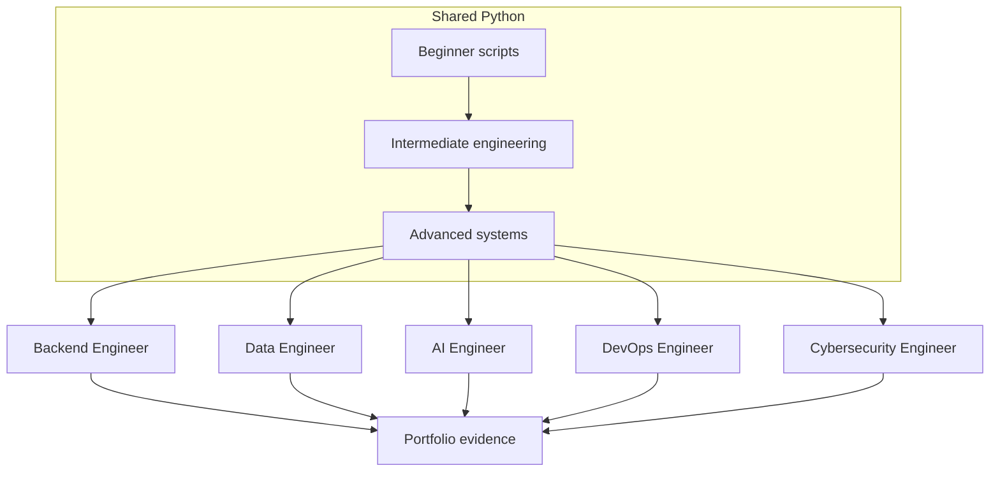

# Career Path Infographic Map

[← Infographics](./README.md) · [Roadmaps](../Roadmaps/README.md)

## Overview

After the three learning levels, Python work splits by the system you own: products, data, models, delivery, or defense. Shared foundations stay in the middle; role evidence lives on the rim.

## Infographic Summary

| Infographic Block | Topic-Specific Takeaway |
| --- | --- |
| 📌 Concept | Career paths reuse the same 110 lessons in different order and depth. |
| ⚡ Purpose | Turn topic coverage into hiring-manager evidence. |
| 🔥 Benefits | Prevents tutorial hopping and duplicate learning. |
| 🎯 Use Cases | Backend APIs, ETL platforms, model serving, CI/CD, and SOC automation. |
| 🚀 Best Practices | Follow a roadmap **Demonstrate** column and ship one project from the catalog. |
| ❌ Common Mistakes | Collecting certificates without a runnable, tested artifact. |

## Role Map

## Role to First Artifact

| Path | First public artifact | Roadmap |
| --- | --- | --- |
| Backend | Containerized CRUD API | [Backend Engineer](../Roadmaps/04-backend-engineer-roadmap.md) |
| Data | Restart-safe ETL sketch | [Data Engineer](../Roadmaps/05-data-engineer-roadmap.md) |
| AI | Model behind FastAPI | [AI Engineer](../Roadmaps/06-ai-engineer-roadmap.md) |
| DevOps | Pipeline with rollback notes | [DevOps Engineer](../Roadmaps/07-devops-engineer-roadmap.md) |
| Cybersecurity | Authorized log-enrichment CLI | [Cybersecurity Engineer](../Roadmaps/08-cybersecurity-engineer-roadmap.md) |
