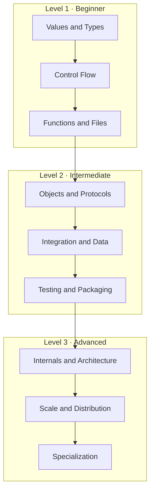
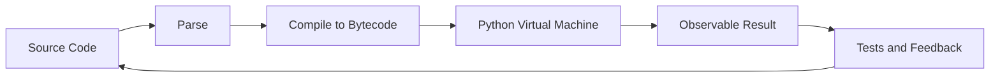
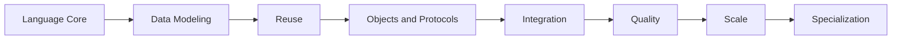

# Python Learning Infographics

[← Knowledge base](../README.md)

## Three-Level Mental Model

## Infographic Block Legend

| Block | Question it answers | Study action |
| --- | --- | --- |
| 📌 Concept | What is the essential mental model? | Explain it in one sentence. |
| ⚡ Purpose | Why does this capability exist? | Name the problem it solves. |
| 🔥 Benefits | What improves when it is applied well? | Identify a measurable benefit. |
| 🎯 Use Cases | Where does it create value? | Connect it to a real system. |
| 🚀 Best Practices | How should professionals apply it? | Add the practice to your code review. |
| ❌ Common Mistakes | What failure modes should you avoid? | Write a failing example, then fix it. |

## Program Execution Model

Every topic document contains a focused infographic table and workflow diagram. Use this directory as the visual entry point, then open the relevant lesson for code and detail.

## Level Maps

| Level | Visual map |
| --- | --- |
| Level 1: Beginner | [Beginner cluster map](./01-beginner-map.md) |
| Level 2: Intermediate | [Intermediate cluster map](./02-intermediate-map.md) |
| Level 3: Advanced | [Advanced cluster map](./03-advanced-map.md) |
| Career specialization | [Career path map](./04-career-path-map.md) |

## Topic Cluster Map

| Cluster | Representative topics | Outcome |
| --- | --- | --- |
| Language core | Syntax, variables, types, operators, control flow | Write correct small scripts |
| Data modeling | Strings, lists, tuples, sets, dictionaries | Choose the right collection |
| Reuse and structure | Functions, modules, packages, project layout | Organize maintainable code |
| Objects and protocols | OOP, iterators, generators, decorators, context managers | Build extensible components |
| Integration | Regex, JSON/CSV/XML, APIs, databases, logging | Connect systems safely |
| Quality | Exceptions, debugging, testing, mocking, packaging | Ship reliable tools |
| Scale | Concurrency, async, distributed systems, performance | Handle load and failure |
| Specialization | Data/AI, web frameworks, cloud, DevOps, security | Align skills to a career path |

