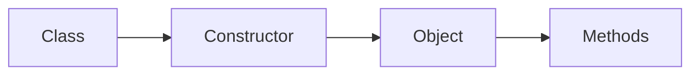

# Object Oriented Programming

## Overview

- **What is it?** OOP organizes code around objects that combine data and behavior.
- **Why is it important?** It models real-world entities and scales large codebases.
- **Where is it used?** Web frameworks, game engines, enterprise apps, SDK design.

## Learning Objectives

- **Skills gained:** Practical command of Object Oriented Programming.
- **Concepts covered:**

- Design classes and objects.
- Apply encapsulation, inheritance, polymorphism.
- Choose OOP vs functional patterns.

- **Expected outcome:** You design maintainable class hierarchies.

## Real World Applications

- Django models
- Fintech domains
- Simulation software
- Game engines

- **Business applications:** Automate workflows, reduce manual errors, accelerate delivery.
- **Career relevance:** Required knowledge for Python roles from junior developer to senior engineer.

## Core Concepts

### Class

- **Definition:** Blueprint for objects.
- **Visual explanation:** `Class` → process → result
- **Practical example:**

```python
class User:
    pass
print(User)
```

### Object

- **Definition:** Instance of a class.
- **Visual explanation:** `Object` → process → result
- **Practical example:**

```python
class Box:
    pass
b = Box()
print(type(b).__name__)
```

### Method

- **Definition:** Function bound to an object.
- **Visual explanation:** `Method` → process → result
- **Practical example:**

```python
class Greeter:
    def hi(self):
        return 'hello'
print(Greeter().hi())
```

## Infographic Summary

| Block | Summary |
| --- | --- |
| 📌 Concept | Objects bundle state and behavior. |
| ⚡ Purpose | Structure complex domains clearly. |
| 🔥 Benefits | Reuse, abstraction, team scalability. |
| 🎯 Use Cases | ORM models, payment systems, inventory systems. |
| 🚀 Best Practices | Composition over inheritance, small public APIs. |
| ❌ Common Mistakes | God classes, deep inheritance trees, anemic models. |

## Syntax Guide

### Basic Syntax

```python
class Dog:
    def bark(self):
        return 'woof'
```

### Standard Structure

```python
class -> instantiate -> call methods
```

### Code Pattern

```python
class Service:
    def run(self):
        return self.execute()
```

## Examples

### Beginner Example

```python
class Rectangle:
    def __init__(self, w, h):
        self.w, self.h = w, h

    def area(self):
        return self.w * self.h


print(Rectangle(4, 5).area())
```

### Intermediate Example

```python
from abc import ABC, abstractmethod


class Notifier(ABC):
    @abstractmethod
    def send(self, message: str) -> None:
        raise NotImplementedError


class EmailNotifier(Notifier):
    def send(self, message: str) -> None:
        print(f"EMAIL: {message}")


EmailNotifier().send('hi')
```

### Advanced Example

```python
class ValidatedModel:
    def __setattr__(self, name, value):
        if name.startswith('_'):
            return super().__setattr__(name, value)
        if name == 'age' and value < 0:
            raise ValueError('age must be non-negative')
        super().__setattr__(name, value)


obj = ValidatedModel()
obj.age = 30
print(obj.age)
```

## Workflow Diagram



---
