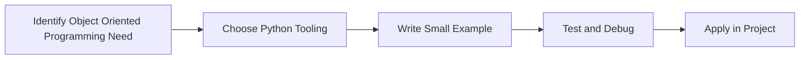

> **Level 2: Intermediate** · Topic 1 of 35

[↑ Level index](../README.md) · [Classes →](./02-classes.md)

# Object Oriented Programming

## Overview
- **What is it?** Object Oriented Programming is a Python knowledge area focused on object-oriented design.
- **Why is it important?** Help developers apply object-oriented design techniques safely, clearly, and consistently.
- **Where is it used?** Domain modeling, application architecture, frameworks, and reusable components.

## Learning Objectives
- Gain the practical skill to explain, write, debug, and review object oriented programming code.
- Cover the vocabulary, syntax, workflow, edge cases, and professional habits behind object oriented programming.
- Expected outcome: you can use object oriented programming in a small project and recognize when it belongs in production code.

## Real World Applications
- **Industry use cases:** Domain modeling, application architecture, frameworks, and reusable components.
- **Business applications:** Reduce manual work, improve reliability, support reporting, automate decisions, and ship maintainable features.
- **Career relevance:** Supports Python developer, backend engineer, data engineer, AI engineer, DevOps engineer, QA automation, and cybersecurity automation roles.

## Core Concepts

### Model
- **Definition:** The main idea that gives object oriented programming its structure and purpose inside a Python program.
- **Visual explanation:** `problem -> Object Oriented Programming model -> clear code`
- **Practical example:**

```python
apply_object_oriented_programming_label = "Object Oriented Programming"
print(apply_object_oriented_programming_label)
```

### Interface
- **Definition:** The ordered steps Python follows when object oriented programming code is created, executed, or integrated.
- **Visual explanation:** `input -> Python operation -> result -> feedback`
- **Practical example:**

```python
class Dog:
    def speak(self):
        return "woof"

print(Dog().speak())
```

### Behavior Rule
- **Definition:** The reliability habit that keeps object oriented programming understandable, testable, secure, and maintainable.
- **Visual explanation:** `working code -> validation -> production confidence`
- **Practical example:**

```python
class Account:
    def __init__(self, balance: float = 0):
        self.balance = balance

    def deposit(self, amount: float) -> None:
        self.balance += amount

account = Account()
account.deposit(50)
print(account.balance)
```

## Infographic Summary

| Infographic Block | Key Message |
| --- | --- |
| 📌 Concept | Object Oriented Programming belongs to the object-oriented design part of Python mastery. |
| ⚡ Purpose | Help developers apply object-oriented design techniques safely, clearly, and consistently. |
| 🔥 Benefits | Stronger maintainability, better reliability, and more professional object-oriented design decisions. |
| 🎯 Use Cases | Domain modeling, application architecture, frameworks, and reusable components. |
| 🚀 Best Practices | Prefer readable names, small examples, explicit errors, tests, documentation, and version-aware choices. |
| ❌ Common Mistakes | Copying code without understanding it, ignoring edge cases, skipping validation, and mixing unrelated responsibilities. |

## Syntax Guide

### Basic Syntax

```python
class Customer:
    def __init__(self, name):
        self.name = name
```

### Standard Structure

```python
def apply_object_oriented_programming(value):
    """Apply the Object Oriented Programming concept to one value."""
    return value

result = apply_object_oriented_programming("practice")
print(result)
```

### Code Pattern

```python
# 1. Identify the Object Oriented Programming problem
# 2. Apply the correct Python structure
# 3. Validate the result with tests or output
```

## Examples

### Beginner Example

```python
class Dog:
    def speak(self):
        return "woof"

print(Dog().speak())
```

### Intermediate Example

```python
class Account:
    def __init__(self, balance: float = 0):
        self.balance = balance

    def deposit(self, amount: float) -> None:
        self.balance += amount

account = Account()
account.deposit(50)
print(account.balance)
```

### Advanced Example

```python
from dataclasses import dataclass

@dataclass
class Order:
    id: int
    total: float

    def is_large(self) -> bool:
        return self.total >= 1000

print(Order(1, 1200).is_large())
```

## Workflow Diagram




---

---

[↑ Level index](../README.md) · [Classes →](./02-classes.md)
