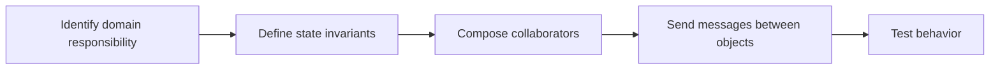

> **Level 2: Intermediate** · Topic 1 of 35

[↑ Level index](../README.md) · [Classes →](./02-classes.md)

# Object Oriented Programming

## Overview
- **What is it?** Object-oriented programming (OOP) organizes software around objects that combine state and behavior, instead of only free-standing procedures.
- **Why is it important?** OOP helps model real domains, encapsulate complexity, and share behavior through composition and inheritance.
- **Where is it used?** Business domain models, GUI frameworks, service layers, plugins, and most large Python applications.

## Learning Objectives
- Separate state, behavior, and collaboration responsibilities.
- Choose composition or inheritance deliberately.
- Keep object boundaries small enough to test.

## Real World Applications
- Model customers, orders, and invoices as collaborating domain objects.
- Structure desktop, web, and game frameworks around reusable component types.
- Keep service boundaries clear so teams can extend behavior without rewriting everything.

## Core Concepts

### Objects and responsibilities
- **Definition:** OOP assigns a cohesive responsibility to an object that owns state and the operations that protect it.
- **Visual explanation:** ``request -> Cart object -> validated state change``
- **Practical example:**

```python
class Cart:
    def __init__(self):
        self.items = []

    def add(self, sku):
        self.items.append(sku)

cart = Cart()
cart.add("BOOK-1")
```

### Composition
- **Definition:** Composition builds behavior by storing collaborating objects, expressing a has-a relationship without coupling subclasses.
- **Visual explanation:** ``Checkout has-a PriceCalculator -> total``
- **Practical example:**

```python
class Checkout:
    def __init__(self, calculator):
        self.calculator = calculator

    def total(self, prices):
        return self.calculator.sum(prices)
```

### Cohesion and coupling
- **Definition:** Cohesion keeps related behavior together; low coupling lets an object depend on a narrow collaborator contract.
- **Visual explanation:** ``cohesive object + narrow boundary -> replaceable parts``
- **Practical example:**

```python
class Notifier:
    def send_receipt(self, order, sender):
        sender(order.customer_email, order.receipt())
```

## Infographic Summary

| Infographic Block | Topic-specific guidance |
| --- | --- |
| 📌 Concept | Object-oriented programming (OOP) organizes software around objects that combine state and behavior, instead of only free-standing procedures. |
| ⚡ Purpose | It provides a vocabulary for modeling changing state, responsibilities, and collaborations without turning every value into a class. |
| 🔥 Benefits | Clear responsibility boundaries, replaceable collaborators, and behavior-focused tests. |
| 🎯 Use Cases | business domain models, GUI components, service layers and plugins |
| 🚀 Best Practices | Model a meaningful responsibility; prefer composition when the relationship is has-a. |
| ❌ Common Mistakes | Creating data-only classes plus one oversized manager object. |

## Syntax Guide

### Basic Syntax

```python
class Temperature:
    def __init__(self, celsius: float):
        self.celsius = celsius

    def fahrenheit(self) -> float:
        return self.celsius * 9 / 5 + 32
```

### Standard Structure

```python
class OrderService:
    def __init__(self, repository, payment_gateway):
        self.repository = repository
        self.payment_gateway = payment_gateway

    def place(self, order):
        self.payment_gateway.charge(order.total)
        self.repository.save(order)
```

### Code Pattern

```python
# 1. Name the domain responsibility.
# 2. Keep its invariants beside its state.
# 3. Inject collaborators through a narrow interface.
# 4. Test observable behavior, not internal attributes.
```

## Examples

### Beginner Example

```python
class Counter:
    def __init__(self):
        self.value = 0

    def increment(self):
        self.value += 1

counter = Counter()
counter.increment()
print(counter.value)
```

### Intermediate Example

```python
class PercentageDiscount:
    def __init__(self, rate: float):
        if not 0 <= rate <= 1:
            raise ValueError("rate must be between 0 and 1")
        self.rate = rate

    def apply(self, amount: float) -> float:
        return amount * (1 - self.rate)

print(PercentageDiscount(0.2).apply(50))
```

### Advanced Example

```python
from dataclasses import dataclass
from typing import Protocol

class TaxPolicy(Protocol):
    def tax_for(self, subtotal: float) -> float: ...

@dataclass(frozen=True)
class Order:
    subtotal: float
    tax_policy: TaxPolicy

    @property
    def total(self) -> float:
        return self.subtotal + self.tax_policy.tax_for(self.subtotal)

class FlatTax:
    def tax_for(self, subtotal: float) -> float:
        return subtotal * 0.1

print(Order(100, FlatTax()).total)
```

## Workflow Diagram



---

[↑ Level index](../README.md) · [Classes →](./02-classes.md)
