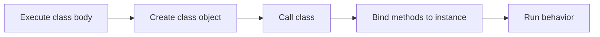

> **Level 2: Intermediate** · Topic 2 of 35

[← Object Oriented Programming](./01-object-oriented-programming.md) · [↑ Level index](../README.md) · [Objects →](./03-objects.md)

# Classes

## Overview
- **What is it?** Classes is the intermediate Python topic of defining reusable types that describe the data and behavior shared by their instances.
- **Why is it important?** A class is the blueprint and namespace; it is not an individual runtime object.
- **Where is it used?** validated domain types, framework models, reusable adapters.

## Learning Objectives
- Define instance, class, and static methods correctly.
- Distinguish class attributes from instance attributes.
- Use class methods as named alternative constructors.

## Real World Applications
- **Engineering:** Validated domain types rely on this topic.
- **Product work:** It supports framework models.
- **Operations:** It appears in reusable adapters.

## Core Concepts

### Class body and namespace
- **Definition:** Executing a class statement creates a namespace and then a class object whose attributes come from that namespace.
- **Visual explanation:** ``class statement -> namespace -> class object``
- **Practical example:**

```python
class Plan:
    currency = "USD"

print(Plan.currency)
```

### Instance methods
- **Definition:** An instance method is a function descriptor that binds the receiving instance to its first parameter, conventionally self.
- **Visual explanation:** ``plan.price() -> Plan.price(plan)``
- **Practical example:**

```python
class Plan:
    def label(self):
        return f"{self.name} plan"

plan = Plan()
plan.name = "Pro"
print(plan.label())
```

### Class and static methods
- **Definition:** A class method receives the class and supports polymorphic factories; a static method is namespaced utility code with no implicit receiver.
- **Visual explanation:** ``cls factory | static utility``
- **Practical example:**

```python
class User:
    @classmethod
    def guest(cls):
        return cls("guest")

    def __init__(self, name):
        self.name = name
```

## Infographic Summary

| Infographic Block | Topic-specific guidance |
| --- | --- |
| 📌 Concept | Class body and namespace, Instance methods, Class and static methods |
| ⚡ Purpose | A class is the blueprint and namespace; it is not an individual runtime object. |
| 🔥 Benefits | Reusable type definitions, shared behavior, and expressive construction APIs. |
| 🎯 Use Cases | validated domain types, framework models, reusable adapters |
| 🚀 Best Practices | Put shared constants on the class and per-object mutable state on each instance. |
| ❌ Common Mistakes | Using a mutable class attribute as if every instance owned a separate value. |

## Syntax Guide

### Basic Syntax

```python
class Product:
    category = "book"

    def title_line(self):
        return self.title.upper()
```

### Standard Structure

```python
class Distance:
    def __init__(self, meters: float):
        self.meters = meters

    @classmethod
    def from_kilometers(cls, kilometers: float):
        return cls(kilometers * 1000)
```

### Code Pattern

```python
# Class attribute: shared definition-level data
# Instance attribute: state unique to one object
# Instance method: behavior using self
# Class method: factory using cls
```

## Examples

### Beginner Example

```python
class Greeter:
    greeting = "Hello"

    def greet(self, name):
        return f"{self.greeting}, {name}"

print(Greeter().greet("Ada"))
```

### Intermediate Example

```python
class InventoryItem:
    tax_rate = 0.2

    def __init__(self, name: str, net_price: float):
        self.name = name
        self.net_price = net_price

    def gross_price(self) -> float:
        return self.net_price * (1 + self.tax_rate)

print(InventoryItem("Keyboard", 50).gross_price())
```

### Advanced Example

```python
class Color:
    def __init__(self, red: int, green: int, blue: int):
        self.red, self.green, self.blue = red, green, blue

    @classmethod
    def from_hex(cls, value: str):
        value = value.removeprefix("#")
        if len(value) != 6:
            raise ValueError("expected six hexadecimal digits")
        return cls(*(int(value[index:index + 2], 16) for index in (0, 2, 4)))

    @staticmethod
    def channel_is_valid(channel: int) -> bool:
        return 0 <= channel <= 255

print(vars(Color.from_hex("#336699")))
```

## Workflow Diagram



---

[← Object Oriented Programming](./01-object-oriented-programming.md) · [↑ Level index](../README.md) · [Objects →](./03-objects.md)
