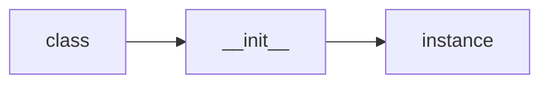

# Classes

## Overview

- **What is it?** Classes define attributes and methods shared by all instances of a type.
- **Why is it important?** They encapsulate data and behavior for a cohesive abstraction.
- **Where is it used?** Domain models, widgets, service clients, test doubles.

## Learning Objectives

- **Skills gained:** Practical command of Classes.
- **Concepts covered:**

- Declare class attributes and methods.
- Use @classmethod and @staticmethod.
- Document public interface.

- **Expected outcome:** You implement classes that represent domain concepts clearly.

## Real World Applications

- ORM entities
- UI components
- Robotics control
- Billing

- **Business applications:** Automate workflows, reduce manual errors, accelerate delivery.
- **Career relevance:** Required knowledge for Python roles from junior developer to senior engineer.

## Core Concepts

### class statement

- **Definition:** Creates a type object.
- **Visual explanation:** `class statement` → process → result
- **Practical example:**

```python
class Point:
    x = 0
print(Point.x)
```

### instance attrs

- **Definition:** Per-object state via self.
- **Visual explanation:** `instance attrs` → process → result
- **Practical example:**

```python
class Counter:
    def __init__(self):
        self.n = 0
print(Counter().n)
```

### methods

- **Definition:** Functions receiving self.
- **Visual explanation:** `methods` → process → result
- **Practical example:**

```python
class Calc:
    def add(self, a, b):
        return a + b
print(Calc().add(2, 3))
```

## Infographic Summary

| Block | Summary |
| --- | --- |
| 📌 Concept | Classes are factories for objects with shared behavior. |
| ⚡ Purpose | Define reusable types with state and operations. |
| 🔥 Benefits | Encapsulation, polymorphism, IDE support. |
| 🎯 Use Cases | Users, orders, sensors, handlers. |
| 🚀 Best Practices | Keep classes focused; prefer dataclasses for data containers. |
| ❌ Common Mistakes | Too many responsibilities, public mutable everything. |

## Syntax Guide

### Basic Syntax

```python
class Account:
    def __init__(self, owner):
        self.owner = owner
```

### Standard Structure

```python
attrs -> __init__ -> methods -> repr/str optional
```

### Code Pattern

```python
class Model:
    def validate(self):
        return True
```

## Examples

### Beginner Example

```python
class Person:
    def __init__(self, name):
        self.name = name
print(Person('Ada').name)
```

### Intermediate Example

```python
class Temperature:
    def __init__(self, celsius: float):
        self.celsius = celsius

    @property
    def fahrenheit(self) -> float:
        return self.celsius * 9 / 5 + 32


print(Temperature(100).fahrenheit)
```

### Advanced Example

```python
from dataclasses import dataclass, field


@dataclass
class Cart:
    items: list[str] = field(default_factory=list)

    def add(self, sku: str) -> None:
        self.items.append(sku)


c = Cart()
c.add('ABC')
print(c.items)
```

## Workflow Diagram



---
