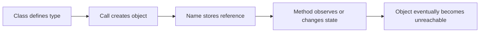

> **Level 2: Intermediate** · Topic 3 of 35

[← Classes](./02-classes.md) · [↑ Level index](../README.md) · [Constructors →](./04-constructors.md)

# Objects

## Overview
- **What is it?** An object is a concrete runtime instance with identity, type, state, and behavior.
- **Why is it important?** Programs manipulate objects; understanding identity versus value prevents subtle bugs and designs clearer APIs.
- **Where is it used?** In-memory graphs, caches, session state, dependency injection, and collaborative domain entities.

## Learning Objectives
- Explain identity, type, and value.
- Recognize aliasing of mutable objects.
- Inspect and compare objects intentionally.

## Real World Applications
- Track distinct shopping-cart instances for concurrent users.
- Share or isolate mutable state intentionally across modules.
- Pass collaborators into services instead of hard-coding global objects.

## Core Concepts

### Identity and type
- **Definition:** Every object has a stable identity during its lifetime and a type that determines its supported operations.
- **Visual explanation:** ``reference -> object identity + type``
- **Practical example:**

```python
item = {"sku": "A1"}
alias = item
print(alias is item, type(item).__name__)
```

### State
- **Definition:** Object state is the data currently stored in an instance; methods may read or transition that state.
- **Visual explanation:** ``method call: state before -> state after``
- **Practical example:**

```python
class Lamp:
    def turn_on(self):
        self.is_on = True

lamp = Lamp()
lamp.turn_on()
```

### Aliasing and equality
- **Definition:** Two names may reference one object; is checks identity while == asks the type to compare values.
- **Visual explanation:** ``a is b: same object | a == b: equivalent value``
- **Practical example:**

```python
first = [1, 2]
second = list(first)
print(first == second, first is second)
```

## Infographic Summary

| Infographic Block | Topic-specific guidance |
| --- | --- |
| 📌 Concept | An object is a concrete runtime instance with identity, type, state, and behavior. |
| ⚡ Purpose | Understanding identity and references prevents accidental aliasing and clarifies when equality differs from sameness. |
| 🔥 Benefits | Predictable identity, controlled state transitions, and safer handling of mutable references. |
| 🎯 Use Cases | stateful entities, in-memory object graphs, dependency collaboration |
| 🚀 Best Practices | Use is for singleton checks such as None and == for value comparison. |
| ❌ Common Mistakes | Assuming assignment copies a mutable object. |

## Syntax Guide

### Basic Syntax

```python
customer = Customer("Ada")  # instantiate an object
print(type(customer))
print(customer.name)
```

### Standard Structure

```python
original = {"tags": ["python"]}
alias = original
copy = {"tags": list(original["tags"])}
alias["tags"].append("oop")
```

### Code Pattern

```python
# 1. Create or receive an object.
# 2. Keep only the references that need it.
# 3. Invoke behavior through its public interface.
# 4. Compare identity and value for the right purpose.
```

## Examples

### Beginner Example

```python
class Note:
    pass

note = Note()
note.text = "Learn object identity"
print(note.text, type(note).__name__)
```

### Intermediate Example

```python
class Thermostat:
    def __init__(self, target: float):
        self.target = target

    def adjust(self, change: float):
        self.target += change

hall = Thermostat(20)
alias = hall
alias.adjust(1.5)
print(hall.target, alias is hall)
```

### Advanced Example

```python
from dataclasses import dataclass

@dataclass(frozen=True)
class Coordinate:
    x: int
    y: int

first = Coordinate(2, 3)
equal_value = Coordinate(2, 3)
same_object = first
print(first == equal_value)
print(first is equal_value)
print(first is same_object)
print({first: "origin offset"})
```

## Workflow Diagram



---

[← Classes](./02-classes.md) · [↑ Level index](../README.md) · [Constructors →](./04-constructors.md)
