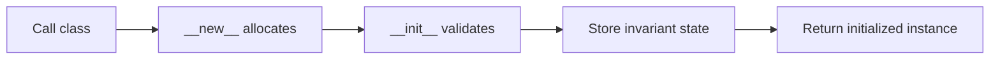

> **Level 2: Intermediate** · Topic 4 of 35

[← Objects](./03-objects.md) · [↑ Level index](../README.md) · [Encapsulation →](./05-encapsulation.md)

# Constructors

## Overview
- **What is it?** Constructors is the intermediate Python topic of establishing valid instance state during object creation.
- **Why is it important?** Python separates allocation in __new__ from initialization in __init__; most application classes customize only __init__.
- **Where is it used?** validated value objects, dependency injection, alternative factories.

## Learning Objectives
- Explain __new__ versus __init__.
- Establish invariants before an instance is used.
- Design keyword-only and alternative constructors.

## Real World Applications
- **Engineering:** Validated value objects rely on this topic.
- **Product work:** It supports dependency injection.
- **Operations:** It appears in alternative factories.

## Core Concepts

### Allocation and initialization
- **Definition:** __new__ allocates and returns an instance; __init__ initializes the already-created instance and must return None.
- **Visual explanation:** ``Class(args) -> __new__ -> instance -> __init__``
- **Practical example:**

```python
class Token:
    def __init__(self, value):
        self.value = value.strip()
```

### Constructor invariants
- **Definition:** A constructor invariant is a condition guaranteed for every successfully initialized instance.
- **Visual explanation:** ``raw arguments -> validation -> valid object``
- **Practical example:**

```python
class Quantity:
    def __init__(self, value):
        if value < 0:
            raise ValueError("quantity cannot be negative")
        self.value = value
```

### Alternative constructors
- **Definition:** A class method can translate another representation and delegate final initialization to cls.
- **Visual explanation:** ``external form -> @classmethod -> cls(...)``
- **Practical example:**

```python
class DateKey:
    @classmethod
    def parse(cls, text):
        year, month = map(int, text.split("-"))
        return cls(year, month)
```

## Infographic Summary

| Infographic Block | Topic-specific guidance |
| --- | --- |
| 📌 Concept | Allocation and initialization, Constructor invariants, Alternative constructors |
| ⚡ Purpose | Python separates allocation in __new__ from initialization in __init__; most application classes customize only __init__. |
| 🔥 Benefits | Valid objects from creation time, centralized normalization, and readable alternative factories. |
| 🎯 Use Cases | validated value objects, dependency injection, alternative factories |
| 🚀 Best Practices | Validate required state once and make optional arguments explicit. |
| ❌ Common Mistakes | Performing network or database work in __init__, making construction slow and failure-prone. |

## Syntax Guide

### Basic Syntax

```python
class User:
    def __init__(self, username: str):
        self.username = username
```

### Standard Structure

```python
class Report:
    def __init__(self, title: str, *, include_details: bool = False):
        if not title.strip():
            raise ValueError("title is required")
        self.title = title.strip()
        self.include_details = include_details
```

### Code Pattern

```python
# 1. Accept the minimum required inputs.
# 2. Normalize and validate them.
# 3. Assign every invariant-bearing attribute.
# 4. Move alternate input formats to class methods.
```

## Examples

### Beginner Example

```python
class Point:
    def __init__(self, x: float, y: float):
        self.x = x
        self.y = y

print(vars(Point(2, 4)))
```

### Intermediate Example

```python
class EmailAddress:
    def __init__(self, value: str):
        normalized = value.strip().lower()
        if normalized.count("@") != 1:
            raise ValueError("invalid email address")
        self.value = normalized

print(EmailAddress(" ADA@EXAMPLE.COM ").value)
```

### Advanced Example

```python
class Money:
    def __new__(cls, amount, currency="USD"):
        if amount == 0:
            return ZERO_USD if currency == "USD" and "ZERO_USD" in globals() else super().__new__(cls)
        return super().__new__(cls)

    def __init__(self, amount, currency="USD"):
        self.amount = amount
        self.currency = currency

    @classmethod
    def parse(cls, text: str):
        currency, amount = text.split()
        return cls(float(amount), currency)

ZERO_USD = Money(0)
print(Money.parse("EUR 19.95").currency)
```

## Workflow Diagram



---

[← Objects](./03-objects.md) · [↑ Level index](../README.md) · [Encapsulation →](./05-encapsulation.md)
