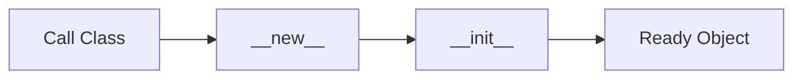

# Constructors

## Overview

- **What is it?** Constructors initialize new objects, primarily via __init__ in Python.
- **Why is it important?** Proper initialization enforces invariants and required dependencies.
- **Where is it used?** Models, clients, widgets, connection wrappers.

## Learning Objectives

- **Skills gained:** Practical command of Constructors.
- **Concepts covered:**

- Implement __init__ with parameters.
- Use default and keyword-only args.
- Avoid heavy work in __init__ when possible.

- **Expected outcome:** You build objects that start in valid, predictable states.

## Real World Applications

- ORM models
- SDK clients
- Hardware drivers
- UI widgets

- **Business applications:** Automate workflows, reduce manual errors, accelerate delivery.
- **Career relevance:** Required knowledge for Python roles from junior developer to senior engineer.

## Core Concepts

### __init__

- **Definition:** Sets up instance after creation.
- **Visual explanation:** `__init__` → process → result
- **Practical example:**

```python
class Item:
    def __init__(self, sku):
        self.sku = sku
print(Item('A1').sku)
```

### __new__

- **Definition:** Creates instance before __init__.
- **Visual explanation:** `__new__` → process → result
- **Practical example:**

```python
class T:
    def __new__(cls):
        return super().__new__(cls)
print(T())
```

### post-init

- **Definition:** dataclass __post_init__ hook.
- **Visual explanation:** `post-init` → process → result
- **Practical example:**

```python
from dataclasses import dataclass
@dataclass
class R:
    w: int
    h: int
    area: int = 0
    def __post_init__(self):
        self.area = self.w * self.h
print(R(3,4).area)
```

## Infographic Summary

| Block | Summary |
| --- | --- |
| 📌 Concept | __init__ configures self; __new__ allocates the instance. |
| ⚡ Purpose | Guarantee valid starting state. |
| 🔥 Benefits | Fewer invalid objects, clearer APIs. |
| 🎯 Use Cases | DB models, API tokens, config objects. |
| 🚀 Best Practices | Keep __init__ cheap; inject dependencies; validate early. |
| ❌ Common Mistakes | I/O in __init__, too many params, subclass __init__ bugs. |

## Syntax Guide

### Basic Syntax

```python
class User:
    def __init__(self, email):
        self.email = email
```

### Standard Structure

```python
__new__ (rare) -> __init__ -> ready object
```

### Code Pattern

```python
def __init__(self, repo):
    self.repo = repo
```

## Examples

### Beginner Example

```python
class Point:
    def __init__(self, x, y):
        self.x, self.y = x, y
print(Point(1, 2).x)
```

### Intermediate Example

```python
class Connection:
    def __init__(self, dsn: str, *, timeout: int = 30):
        self.dsn = dsn
        self.timeout = timeout


print(Connection('sqlite://', timeout=10).timeout)
```

### Advanced Example

```python
class Buffer:
    def __init__(self, data: bytes):
        if not data:
            raise ValueError('empty buffer')
        self._data = data

    @property
    def size(self) -> int:
        return len(self._data)


print(Buffer(b'abc').size)
```

## Workflow Diagram



---
