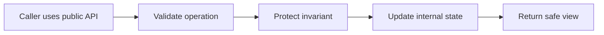

> **Level 2: Intermediate** · Topic 5 of 35

[← Constructors](./04-constructors.md) · [↑ Level index](../README.md) · [Inheritance →](./06-inheritance.md)

# Encapsulation

## Overview
- **What is it?** Encapsulation hides internal representation behind a small public interface that protects invariants.
- **Why is it important?** It reduces coupling, prevents invalid state changes, and lets internals evolve without breaking callers.
- **Where is it used?** Domain aggregates, libraries, SDKs, and any API where misuse would corrupt data.

## Learning Objectives
- Design public and non-public interfaces.
- Use properties for controlled attribute access.
- Explain why name mangling is not security.

## Real World Applications
- Keep bank balances mutable only through deposit and withdraw methods.
- Expose properties instead of raw fields for validated settings.
- Ship libraries that can change storage format without breaking clients.

## Core Concepts

### Public interface
- **Definition:** A public interface is the supported set of attributes and methods callers may depend on.
- **Visual explanation:** ``caller -> public methods -> internal state``
- **Practical example:**

```python
class QueueDepth:
    def __init__(self):
        self._value = 0

    def increment(self):
        self._value += 1
```

### Properties
- **Definition:** A property preserves attribute-style access while centralizing validation or computed behavior.
- **Visual explanation:** ``assignment -> setter validation -> _stored value``
- **Practical example:**

```python
class Score:
    @property
    def value(self):
        return self._value
```

### Underscores and mangling
- **Definition:** A leading underscore signals non-public API; double-leading names are class-mangled mainly to avoid subclass collisions.
- **Visual explanation:** ``_internal: convention | __name: _Class__name``
- **Practical example:**

```python
class Base:
    def __init__(self):
        self.__version = 1
```

## Infographic Summary

| Infographic Block | Topic-specific guidance |
| --- | --- |
| 📌 Concept | Encapsulation hides internal representation behind a small public interface that protects invariants. |
| ⚡ Purpose | Python uses conventions, properties, and name mangling rather than absolute private access control. |
| 🔥 Benefits | Protected invariants, stable public APIs, and freedom to change internal representation. |
| 🎯 Use Cases | validated account state, stable library APIs, replaceable implementations |
| 🚀 Best Practices | Expose behavior that preserves invariants instead of mutable internal containers. |
| ❌ Common Mistakes | Treating double underscores as a security boundary. |

## Syntax Guide

### Basic Syntax

```python
class Wallet:
    def __init__(self):
        self._balance = 0

    def deposit(self, amount):
        self._balance += amount
```

### Standard Structure

```python
class Percentage:
    def __init__(self, value: float):
        self.value = value

    @property
    def value(self) -> float:
        return self._value

    @value.setter
    def value(self, candidate: float):
        if not 0 <= candidate <= 100:
            raise ValueError("percentage out of range")
        self._value = candidate
```

### Code Pattern

```python
# Public method -> validate request
# Internal state -> update atomically
# Read-only property -> expose safe observation
# Leading underscore -> mark implementation detail
```

## Examples

### Beginner Example

```python
class Light:
    def __init__(self):
        self._is_on = False

    def switch_on(self):
        self._is_on = True

    def status(self):
        return "on" if self._is_on else "off"

light = Light()
light.switch_on()
print(light.status())
```

### Intermediate Example

```python
class BankAccount:
    def __init__(self, opening_balance: float = 0):
        if opening_balance < 0:
            raise ValueError("negative opening balance")
        self._balance = opening_balance

    @property
    def balance(self) -> float:
        return self._balance

    def withdraw(self, amount: float):
        if amount <= 0 or amount > self._balance:
            raise ValueError("invalid withdrawal")
        self._balance -= amount

account = BankAccount(100)
account.withdraw(25)
print(account.balance)
```

### Advanced Example

```python
class Playlist:
    def __init__(self, tracks=()):
        self.__tracks = list(tracks)

    @property
    def tracks(self) -> tuple[str, ...]:
        return tuple(self.__tracks)

    def add(self, track: str):
        if not track.strip():
            raise ValueError("track title is required")
        self.__tracks.append(track.strip())

playlist = Playlist(["Intro"])
snapshot = playlist.tracks
playlist.add("Finale")
print(snapshot, playlist.tracks)
```

## Workflow Diagram



---

[← Constructors](./04-constructors.md) · [↑ Level index](../README.md) · [Inheritance →](./06-inheritance.md)
