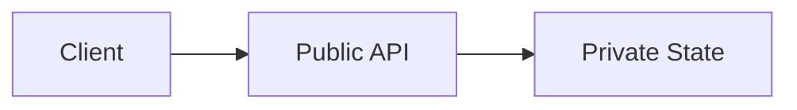

# Encapsulation

## Overview

- **What is it?** Encapsulation hides internal state and exposes a controlled public interface.
- **Why is it important?** It protects invariants and reduces coupling between components.
- **Where is it used?** Libraries, domain models, API clients, device drivers.

## Learning Objectives

- **Skills gained:** Practical command of Encapsulation.
- **Concepts covered:**

- Use private-by-convention _attrs.
- Expose @property for controlled access.
- Design minimal public methods.

- **Expected outcome:** You prevent accidental misuse of internal object state.

## Real World Applications

- Payment vaults
- Medical records
- Embedded firmware APIs
- SaaS SDKs

- **Business applications:** Automate workflows, reduce manual errors, accelerate delivery.
- **Career relevance:** Required knowledge for Python roles from junior developer to senior engineer.

## Core Concepts

### Name mangling

- **Definition:** Double underscore alters name.
- **Visual explanation:** `Name mangling` → process → result
- **Practical example:**

```python
class A:
    def __init__(self):
        self.__secret = 1
    def get(self):
        return self.__secret
print(A().get())
```

### property

- **Definition:** Getter/setter as attribute.
- **Visual explanation:** `property` → process → result
- **Practical example:**

```python
class Circle:
    def __init__(self, r):
        self.radius = r
    @property
    def diameter(self):
        return self.radius * 2
print(Circle(3).diameter)
```

### Public API

- **Definition:** Document supported methods.
- **Visual explanation:** `Public API` → process → result
- **Practical example:**

```python
class Service:
    def run(self):
        return self._execute()
    def _execute(self):
        return 'ok'
print(Service().run())
```

## Infographic Summary

| Block | Summary |
| --- | --- |
| 📌 Concept | Encapsulation separates interface from implementation. |
| ⚡ Purpose | Protect data integrity and enable refactoring. |
| 🔥 Benefits | Safer changes, clearer contracts, fewer bugs. |
| 🎯 Use Cases | Bank accounts, validated configs, cached clients. |
| 🚀 Best Practices | Properties over getters; don't over-mangle; be consistent. |
| ❌ Common Mistakes | Everything public, leaky abstractions, property side effects. |

## Syntax Guide

### Basic Syntax

```python
class Account:
    def __init__(self):
        self._balance = 0.0
```

### Standard Structure

```python
private state -> properties -> public methods
```

### Code Pattern

```python
value = obj.value  # property-backed access
```

## Examples

### Beginner Example

```python
class Counter:
    def __init__(self):
        self._n = 0
    def inc(self):
        self._n += 1
    def value(self):
        return self._n
c = Counter(); c.inc(); print(c.value())
```

### Intermediate Example

```python
class Email:
    def __init__(self, address: str):
        self.address = address.lower()

    @property
    def domain(self) -> str:
        return self.address.split('@', 1)[1]


print(Email('Ada@Example.com').domain)
```

### Advanced Example

```python
class RateLimiter:
    def __init__(self, limit: int):
        self._limit = limit
        self._count = 0

    def allow(self) -> bool:
        if self._count >= self._limit:
            return False
        self._count += 1
        return True


rl = RateLimiter(2)
print(rl.allow(), rl.allow(), rl.allow())
```

## Workflow Diagram



---
