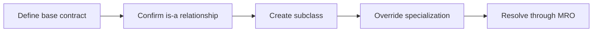

> **Level 2: Intermediate** · Topic 6 of 35

[← Encapsulation](./05-encapsulation.md) · [↑ Level index](../README.md) · [Polymorphism →](./07-polymorphism.md)

# Inheritance

## Overview
- **What is it?** Inheritance is the intermediate Python topic of specializing behavior through an is-a relationship between classes.
- **Why is it important?** Inheritance can reuse and extend contracts, but composition is safer when substitutability does not hold.
- **Where is it used?** framework extension points, exception hierarchies, related domain variants.

## Learning Objectives
- Apply is-a and substitutability tests.
- Override methods and use super correctly.
- Understand method resolution order.

## Real World Applications
- **Engineering:** Framework extension points rely on this topic.
- **Product work:** It supports exception hierarchies.
- **Operations:** It appears in related domain variants.

## Core Concepts

### Subclass relationship
- **Definition:** A subclass inherits attributes and should remain usable wherever its base-class contract is expected.
- **Visual explanation:** ``Dog is-an Animal -> inherited interface``
- **Practical example:**

```python
class Animal:
    def move(self):
        return "moving"

class Bird(Animal):
    pass
```

### Overriding and super
- **Definition:** Overriding replaces inherited behavior; super delegates to the next implementation in the method resolution order.
- **Visual explanation:** ``subclass method -> super() -> next MRO method``
- **Practical example:**

```python
class TrackedList(list):
    def append(self, value):
        print("adding", value)
        super().append(value)
```

### Method resolution order
- **Definition:** The MRO is the deterministic class search order used for attributes, including cooperative multiple inheritance.
- **Visual explanation:** ``Child.__mro__: Child -> mixins -> Base -> object``
- **Practical example:**

```python
class JsonMixin:
    def format(self):
        return "{}"

class Response(JsonMixin):
    pass
```

## Infographic Summary

| Infographic Block | Topic-specific guidance |
| --- | --- |
| 📌 Concept | Subclass relationship, Overriding and super, Method resolution order |
| ⚡ Purpose | Inheritance can reuse and extend contracts, but composition is safer when substitutability does not hold. |
| 🔥 Benefits | Focused specialization, framework extensibility, and reusable behavior where substitutability holds. |
| 🎯 Use Cases | framework extension points, exception hierarchies, related domain variants |
| 🚀 Best Practices | Inherit only when the subtype honors the complete base contract. |
| ❌ Common Mistakes | Inheriting solely to reuse one helper method. |

## Syntax Guide

### Basic Syntax

```python
class Employee:
    def describe(self):
        return "employee"

class Manager(Employee):
    pass
```

### Standard Structure

```python
class Message:
    def render(self):
        raise NotImplementedError

class TextMessage(Message):
    def __init__(self, text):
        self.text = text

    def render(self):
        return self.text
```

### Code Pattern

```python
# 1. Verify the subtype is-a base type.
# 2. Preserve input and output expectations.
# 3. Override only specialization points.
# 4. Use super() for cooperative behavior.
```

## Examples

### Beginner Example

```python
class Vehicle:
    def description(self):
        return "vehicle"

class Bicycle(Vehicle):
    def description(self):
        return "pedal bicycle"

print(Bicycle().description())
```

### Intermediate Example

```python
class Notification:
    def __init__(self, recipient: str):
        self.recipient = recipient

    def summary(self) -> str:
        return f"to {self.recipient}"

class EmailNotification(Notification):
    def __init__(self, recipient: str, subject: str):
        super().__init__(recipient)
        self.subject = subject

    def summary(self) -> str:
        return f"{self.subject} {super().summary()}"

print(EmailNotification("ada@example.com", "Welcome").summary())
```

### Advanced Example

```python
class AuditMixin:
    def save(self):
        print("audit before save")
        return super().save()

class TimestampMixin:
    def save(self):
        print("timestamp before save")
        return super().save()

class Record:
    def save(self):
        return "stored"

class AuditedRecord(AuditMixin, TimestampMixin, Record):
    pass

record = AuditedRecord()
print(record.save())
print([cls.__name__ for cls in AuditedRecord.__mro__])
```

## Workflow Diagram



---

[← Encapsulation](./05-encapsulation.md) · [↑ Level index](../README.md) · [Polymorphism →](./07-polymorphism.md)
