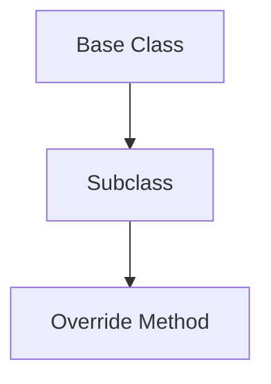

# Inheritance

## Overview

- **What is it?** Inheritance lets a subclass reuse and extend a base class.
- **Why is it important?** Shared behavior avoids duplication; specialization models subtypes.
- **Where is it used?** Framework hooks, UI kits, exception hierarchies, plugins.

## Learning Objectives

- **Skills gained:** Practical command of Inheritance.
- **Concepts covered:**

- Subclass and override methods.
- Call super() correctly.
- Prefer composition when reuse is shallow.

- **Expected outcome:** You extend existing classes without breaking Liskov expectations.

## Real World Applications

- Web frameworks
- Game engines
- Enterprise ERP
- Test fixtures

- **Business applications:** Automate workflows, reduce manual errors, accelerate delivery.
- **Career relevance:** Required knowledge for Python roles from junior developer to senior engineer.

## Core Concepts

### Subclass

- **Definition:** class Child(Parent).
- **Visual explanation:** `Subclass` → process → result
- **Practical example:**

```python
class Animal:
    def speak(self):
        return 'sound'
class Dog(Animal):
    def speak(self):
        return 'woof'
print(Dog().speak())
```

### super()

- **Definition:** Delegate to parent implementation.
- **Visual explanation:** `super()` → process → result
- **Practical example:**

```python
class B:
    def val(self):
        return 1
class C(B):
    def val(self):
        return super().val() + 1
print(C().val())
```

### MRO

- **Definition:** Method resolution order.
- **Visual explanation:** `MRO` → process → result
- **Practical example:**

```python
class A:
    def f(self):
        return 'A'
class B(A):
    pass
print(B().f())
```

## Infographic Summary

| Block | Summary |
| --- | --- |
| 📌 Concept | Inheritance is an is-a relationship between types. |
| ⚡ Purpose | Reuse and specialize behavior. |
| 🔥 Benefits | DRY, polymorphic collections, framework extension. |
| 🎯 Use Cases | Custom exceptions, model subclasses, auth backends. |
| 🚀 Best Practices | Shallow trees; override thoughtfully; document contracts. |
| ❌ Common Mistakes | Fragile base class, super misuse, deep hierarchies. |

## Syntax Guide

### Basic Syntax

```python
class Employee(Person):
    def role(self):
        return 'staff'
```

### Standard Structure

```python
base -> override -> super optional
```

### Code Pattern

```python
class Admin(User):
    def permissions(self):
        return super().permissions() | {'admin'}
```

## Examples

### Beginner Example

```python
class Bird:
    def move(self):
        return 'fly'
class Penguin(Bird):
    def move(self):
        return 'swim'
print(Penguin().move())
```

### Intermediate Example

```python
class Logger:
    def log(self, msg: str) -> None:
        print(msg)


class TimestampLogger(Logger):
    def log(self, msg: str) -> None:
        super().log(f'[ts] {msg}')


TimestampLogger().log('start')
```

### Advanced Example

```python
class Shape:
    def area(self) -> float:
        raise NotImplementedError


class Square(Shape):
    def __init__(self, side: float):
        self.side = side

    def area(self) -> float:
        return self.side ** 2


print(Square(4).area())
```

## Workflow Diagram



---
