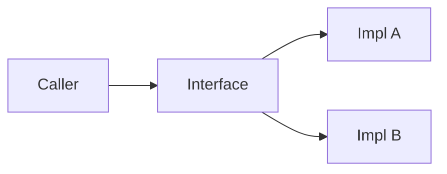

# Polymorphism

## Overview

- **What is it?** Polymorphism lets different types respond to the same interface.
- **Why is it important?** Callers depend on behavior, not concrete classes.
- **Where is it used?** Duck typing, protocols, plugin systems, strategy pattern.

## Learning Objectives

- **Skills gained:** Practical command of Polymorphism.
- **Concepts covered:**

- Write code against shared interfaces.
- Use duck typing safely.
- Combine polymorphism with ABCs or Protocols.

- **Expected outcome:** You write flexible code that accepts multiple implementations.

## Real World Applications

- Payment providers
- Cloud storage drivers
- Notification channels
- ML backends

- **Business applications:** Automate workflows, reduce manual errors, accelerate delivery.
- **Career relevance:** Required knowledge for Python roles from junior developer to senior engineer.

## Core Concepts

### Duck typing

- **Definition:** If it quacks, use it.
- **Visual explanation:** `Duck typing` → process → result
- **Practical example:**

```python
class Duck:
    def quack(self):
        return 'quack'
def speak(bird):
    return bird.quack()
print(speak(Duck()))
```

### Override

- **Definition:** Subclass provides own version.
- **Visual explanation:** `Override` → process → result
- **Practical example:**

```python
class A:
    def run(self):
        return 1
class B(A):
    def run(self):
        return 2
print(B().run())
```

### Protocol

- **Definition:** Structural typing.
- **Visual explanation:** `Protocol` → process → result
- **Practical example:**

```python
from typing import Protocol
class Runner(Protocol):
    def run(self) -> int: ...
class Job:
    def run(self) -> int:
        return 42
def start(r: Runner) -> int:
    return r.run()
print(start(Job()))
```

## Infographic Summary

| Block | Summary |
| --- | --- |
| 📌 Concept | Polymorphism emphasizes behavior over concrete type. |
| ⚡ Purpose | Decouple callers from implementations. |
| 🔥 Benefits | Extensibility, testing with fakes, cleaner APIs. |
| 🎯 Use Cases | Strategies, serializers, renderers. |
| 🚀 Best Practices | Small interfaces; type hints with Protocol; test all impls. |
| ❌ Common Mistakes | isinstance chains everywhere, violating LSP, hidden requirements. |

## Syntax Guide

### Basic Syntax

```python
def render(doc):
    return doc.to_html()
```

### Standard Structure

```python
interface -> multiple impls -> caller uses interface
```

### Code Pattern

```python
for handler in handlers:
    handler.process(event)
```

## Examples

### Beginner Example

```python
class Cat:
    def sound(self):
        return 'meow'
class Dog:
    def sound(self):
        return 'woof'
print([C().sound() for C in (Cat, Dog)])
```

### Intermediate Example

```python
class JSONRenderer:
    def render(self, data: dict) -> str:
        import json
        return json.dumps(data)


class XMLRenderer:
    def render(self, data: dict) -> str:
        return '<root/>'


def export(renderer, payload):
    return renderer.render(payload)


print(export(JSONRenderer(), {'a': 1}))
```

### Advanced Example

```python
from typing import Protocol


class SupportsClose(Protocol):
    def close(self) -> None: ...


def cleanup(resource: SupportsClose) -> None:
    resource.close()


class FileLike:
    def close(self) -> None:
        print('closed')


cleanup(FileLike())
```

## Workflow Diagram



---
