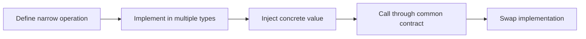

> **Level 2: Intermediate** · Topic 7 of 35

[← Inheritance](./06-inheritance.md) · [↑ Level index](../README.md) · [Abstraction →](./08-abstraction.md)

# Polymorphism

## Overview
- **What is it?** Polymorphism lets the same operation work with values of different concrete types that share a contract.
- **Why is it important?** Callers can depend on behavior, not concrete classes, which makes systems extensible and testable.
- **Where is it used?** Payment processors, serializers, notification channels, storage backends, and plugin systems.

## Learning Objectives
- Use duck typing safely.
- Define structural contracts with Protocol.
- Distinguish polymorphism from inheritance.

## Real World Applications
- Swap credit-card, wallet, and invoice processors behind one pay() interface.
- Render reports to PDF, CSV, or HTML without changing reporting logic.
- Inject fake collaborators in tests that honor the same protocol.

## Core Concepts

### Duck typing
- **Definition:** Duck typing accepts any object supporting the required operations, regardless of its inheritance tree.
- **Visual explanation:** ``different types -> same required method -> caller``
- **Practical example:**

```python
def announce(item):
    return item.label()
```

### Substitution
- **Definition:** Polymorphic implementations must preserve the caller-visible contract, including accepted inputs, results, and errors.
- **Visual explanation:** ``contract -> implementation A | B | C``
- **Practical example:**

```python
def total(pricer, items):
    return pricer.price(items)
```

### Protocols
- **Definition:** A typing Protocol describes a structural interface that static checkers can verify without runtime inheritance.
- **Visual explanation:** ``Protocol shape <- structurally matching classes``
- **Practical example:**

```python
from typing import Protocol

class Renderable(Protocol):
    def render(self) -> str: ...
```

## Infographic Summary

| Infographic Block | Topic-specific guidance |
| --- | --- |
| 📌 Concept | Polymorphism lets the same operation work with values of different concrete types that share a contract. |
| ⚡ Purpose | Python commonly achieves polymorphism through duck typing and protocols, not only inheritance. |
| 🔥 Benefits | Interchangeable implementations, smaller caller dependencies, and easier extension without type switches. |
| 🎯 Use Cases | payment strategies, serializers, replaceable infrastructure adapters |
| 🚀 Best Practices | Depend on the smallest behavior the caller actually needs. |
| ❌ Common Mistakes | Using isinstance chains instead of asking objects to perform their behavior. |

## Syntax Guide

### Basic Syntax

```python
def print_area(shape):
    print(shape.area())  # any object with area() works
```

### Standard Structure

```python
from typing import Protocol

class Compressor(Protocol):
    def compress(self, data: bytes) -> bytes: ...

def archive(data: bytes, compressor: Compressor) -> bytes:
    return compressor.compress(data)
```

### Code Pattern

```python
# Caller depends on one operation.
# Multiple unrelated types implement that operation.
# Contract semantics stay consistent.
# Select an implementation outside the caller.
```

## Examples

### Beginner Example

```python
class Cat:
    def speak(self):
        return "meow"

class Alarm:
    def speak(self):
        return "beep"

for speaker in (Cat(), Alarm()):
    print(speaker.speak())
```

### Intermediate Example

```python
class CardPayment:
    def pay(self, cents: int) -> str:
        return f"charged card {cents}"

class WalletPayment:
    def pay(self, cents: int) -> str:
        return f"debited wallet {cents}"

def checkout(method, cents: int) -> str:
    return method.pay(cents)

print(checkout(CardPayment(), 2500))
print(checkout(WalletPayment(), 2500))
```

### Advanced Example

```python
from dataclasses import dataclass
from typing import Protocol

class Formatter(Protocol):
    def format(self, fields: dict[str, str]) -> str: ...

class LineFormatter:
    def format(self, fields: dict[str, str]) -> str:
        return " | ".join(f"{key}={value}" for key, value in fields.items())

@dataclass
class Report:
    fields: dict[str, str]

    def render(self, formatter: Formatter) -> str:
        return formatter.format(self.fields)

print(Report({"status": "ok"}).render(LineFormatter()))
```

## Workflow Diagram



---

[← Inheritance](./06-inheritance.md) · [↑ Level index](../README.md) · [Abstraction →](./08-abstraction.md)
