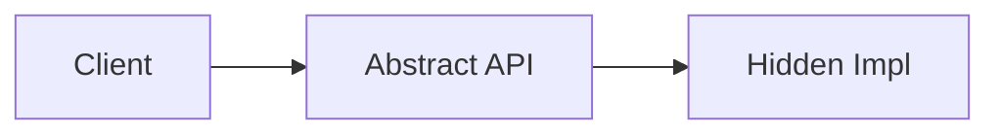

# Abstraction

## Overview

- **What is it?** Abstraction hides complexity behind simpler interfaces.
- **Why is it important?** Teams work at appropriate levels without knowing every detail.
- **Where is it used?** APIs, ORMs, cloud SDKs, hardware abstraction layers.

## Learning Objectives

- **Skills gained:** Practical command of Abstraction.
- **Concepts covered:**

- Define abstract base classes.
- Hide implementation details.
- Document contracts clearly.

- **Expected outcome:** You expose only what clients need while refactoring internals freely.

## Real World Applications

- Cloud SDKs
- Database layers
- GUI toolkits
- Compiler frontends

- **Business applications:** Automate workflows, reduce manual errors, accelerate delivery.
- **Career relevance:** Required knowledge for Python roles from junior developer to senior engineer.

## Core Concepts

### ABC

- **Definition:** Abstract base class enforces methods.
- **Visual explanation:** `ABC` → process → result
- **Practical example:**

```python
from abc import ABC, abstractmethod
class Repo(ABC):
    @abstractmethod
    def get(self, id: int): ...
class MemRepo(Repo):
    def get(self, id: int):
        return {'id': id}
print(MemRepo().get(1))
```

### Facade

- **Definition:** Simple wrapper over subsystems.
- **Visual explanation:** `Facade` → process → result
- **Practical example:**

```python
class Storage:
    def save(self, text: str) -> None:
        open('out.txt', 'w').write(text)
Storage().save('hi')
```

### Interface segregation

- **Definition:** Small focused interfaces.
- **Visual explanation:** `Interface segregation` → process → result
- **Practical example:**

```python
class Reader:
    def read(self):
        return 'data'
print(Reader().read())
```

## Infographic Summary

| Block | Summary |
| --- | --- |
| 📌 Concept | Abstraction emphasizes what, not how. |
| ⚡ Purpose | Manage complexity and enable change. |
| 🔥 Benefits | Faster client dev, safer refactors, clearer modules. |
| 🎯 Use Cases | Payment gateway facade, storage adapter, ML pipeline stage. |
| 🚀 Best Practices | Stable public APIs; version breaking changes; tests on contracts. |
| ❌ Common Mistakes | Leaking internals, giant interfaces, abstract everything. |

## Syntax Guide

### Basic Syntax

```python
class API:
    def fetch(self):
        return self._request()
```

### Standard Structure

```python
public facade -> private implementation
```

### Code Pattern

```python
class Service:
    def run(self):
        return self._pipeline()
```

## Examples

### Beginner Example

```python
class Clock:
    def now_iso(self):
        from datetime import datetime, timezone
        return datetime.now(timezone.utc).isoformat()
print(Clock().now_iso()[:4])
```

### Intermediate Example

```python
from abc import ABC, abstractmethod


class PaymentGateway(ABC):
    @abstractmethod
    def charge(self, amount: float) -> str:
        raise NotImplementedError


class FakeGateway(PaymentGateway):
    def charge(self, amount: float) -> str:
        return f'charged {amount:.2f}'


print(FakeGateway().charge(9.99))
```

### Advanced Example

```python
class Database:
    def __init__(self):
        self._connected = True

    def query(self, sql: str) -> list[tuple]:
        return [('row',)] if self._connected else []


class UserRepository:
    def __init__(self, db: Database):
        self._db = db

    def list_users(self) -> list[tuple]:
        return self._db.query('SELECT 1')


print(UserRepository(Database()).list_users())
```

## Workflow Diagram



---
