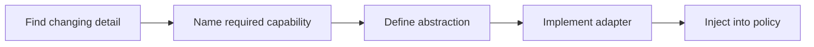

> **Level 2: Intermediate** · Topic 8 of 35

[← Polymorphism](./07-polymorphism.md) · [↑ Level index](../README.md) · [Magic Methods →](./09-magic-methods.md)

# Abstraction

## Overview
- **What is it?** Abstraction is the intermediate Python topic of exposing essential operations while hiding implementation details.
- **Why is it important?** Abstraction controls what callers must know; Python supports informal interfaces, Protocol, and abstract base classes.
- **Where is it used?** storage ports, plugin contracts, service boundaries.

## Learning Objectives
- Separate interface from implementation.
- Use ABC when runtime enforcement is useful.
- Avoid abstractions with only one speculative use.

## Real World Applications
- **Engineering:** Storage ports rely on this topic.
- **Product work:** It supports plugin contracts.
- **Operations:** It appears in service boundaries.

## Core Concepts

### Interface boundary
- **Definition:** An abstraction names the capability a caller needs without exposing how a concrete provider performs it.
- **Visual explanation:** ``caller -> capability -> hidden implementation``
- **Practical example:**

```python
def publish(message, channel):
    channel.send(message)
```

### Abstract base classes
- **Definition:** An ABC can prevent instantiation until subclasses implement methods marked abstractmethod.
- **Visual explanation:** ``ABC contract -> concrete subclass -> instance``
- **Practical example:**

```python
from abc import ABC, abstractmethod

class Store(ABC):
    @abstractmethod
    def get(self, key): ...
```

### Dependency inversion
- **Definition:** High-level policy depends on an abstraction supplied from outside rather than constructing low-level infrastructure.
- **Visual explanation:** ``business policy -> port <- database adapter``
- **Practical example:**

```python
class Catalog:
    def __init__(self, repository):
        self.repository = repository
```

## Infographic Summary

| Infographic Block | Topic-specific guidance |
| --- | --- |
| 📌 Concept | Interface boundary, Abstract base classes, Dependency inversion |
| ⚡ Purpose | Abstraction controls what callers must know; Python supports informal interfaces, Protocol, and abstract base classes. |
| 🔥 Benefits | Lower coupling, testable high-level policy, and replaceable infrastructure adapters. |
| 🎯 Use Cases | storage ports, plugin contracts, service boundaries |
| 🚀 Best Practices | Abstract around a stable capability at a real change boundary. |
| ❌ Common Mistakes | Adding layers that merely rename one concrete method. |

## Syntax Guide

### Basic Syntax

```python
from abc import ABC, abstractmethod

class Exporter(ABC):
    @abstractmethod
    def export(self, rows):
        raise NotImplementedError
```

### Standard Structure

```python
class BillingService:
    def __init__(self, gateway):
        self.gateway = gateway

    def bill(self, customer, cents):
        return self.gateway.charge(customer, cents)
```

### Code Pattern

```python
# High-level code states the needed capability.
# Concrete adapter implements that capability.
# Composition root selects the adapter.
# Tests supply a small in-memory implementation.
```

## Examples

### Beginner Example

```python
from abc import ABC, abstractmethod

class Shape(ABC):
    @abstractmethod
    def area(self) -> float:
        raise NotImplementedError

class Square(Shape):
    def __init__(self, side: float):
        self.side = side

    def area(self) -> float:
        return self.side ** 2

print(Square(4).area())
```

### Intermediate Example

```python
class MemoryRepository:
    def __init__(self):
        self.records = {}

    def save(self, key, value):
        self.records[key] = value

class Registration:
    def __init__(self, repository):
        self.repository = repository

    def register(self, username):
        self.repository.save(username, {"active": True})

repository = MemoryRepository()
Registration(repository).register("ada")
print(repository.records)
```

### Advanced Example

```python
from typing import Protocol

class KeyValueStore(Protocol):
    def read(self, key: str) -> str | None: ...
    def write(self, key: str, value: str) -> None: ...

class FeatureFlags:
    def __init__(self, store: KeyValueStore):
        self.store = store

    def enabled(self, name: str) -> bool:
        return self.store.read(name) == "on"

class DictStore:
    def __init__(self):
        self.data: dict[str, str] = {}

    def read(self, key):
        return self.data.get(key)

    def write(self, key, value):
        self.data[key] = value

store = DictStore()
store.write("search-v2", "on")
print(FeatureFlags(store).enabled("search-v2"))
```

## Workflow Diagram



---

[← Polymorphism](./07-polymorphism.md) · [↑ Level index](../README.md) · [Magic Methods →](./09-magic-methods.md)
